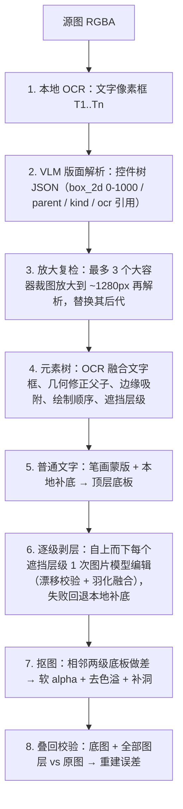

# 精准拆层流水线原理与排错

代码：`src/shared/graph/uiPreciseSplit/`（纯 RGBA 计算，可单测）+ 执行器适配 `src/shared/graph/execute/layerSplitPrecise.ts`。

## 流水线

### 关键设计

- **遮挡层级**：元素 level = 1 + 与它重叠（> 较小面积 6%）的更早绘制元素的最大 level。同一层级的元素互不遮挡，可在一次图片编辑里一起移除。
- **抠图不靠猜**：第 k 级元素 = `plate[k+1]`（含该元素）与 `plate[k]`（已移除）之差，alpha 由合成方程下界 + 噪声自适应阈值求得，所以半透明发光、阴影也能保留。
- **漂移防护**：图片模型返回的底板先缩放到原尺寸，SAD 搜索平移量；误差 > 24 直接拒绝，只在元素矩形（羽化）内采用模型像素，其他区域保持原图逐像素一致。
- **文字**：普通文字的几何来自 OCR（像素级准确），内容优先采用 VLM 读法（OCR 与 VLM 相似度 < 0.25 时用 OCR）；艺术字（描边 / 渐变 / 特效字）当普通元素剥层。

## 日志字段（运行日志里搜 `[precise-split]`）

| 日志                            | 含义                                                                        |
| ------------------------------- | --------------------------------------------------------------------------- |
| `ocr: N text boxes`             | 本地 OCR 文字框数；0 表示 OCR 不可用，只靠 VLM                              |
| `vlm layout: N elements`        | 首轮版面元素数                                                              |
| `zoom refine "X": a → b`        | 容器 X 放大复检后的子元素数变化                                             |
| `peel Lk: generative×n`         | 第 k 级用图片模型补底；`local` = 本地补底；`transparent` = 元素在透明区域上 |
| `skip "X": no separable pixels` | 元素与下层底板无差异（框错 / 重复元素）                                     |
| `reconstruction error`          | 叠回误差（0–255）；< 3 很好，> 6 需要检查                                   |

## 常见问题

| 现象                                     | 原因 / 处理                                                                                                               |
| ---------------------------------------- | ------------------------------------------------------------------------------------------------------------------------- |
| 报「精准拆层失败：请启用多模态文本模型」 | 没有启用支持看图的文本模型，或模型返回非 JSON。到设置里启用 Gemini 2.5/3 Pro；或在节点参数 `visionModel` 指定             |
| 元素少、漏小图标                         | 用 Gemini Pro 而不是 Flash；在拆层提示词里点名需要单独拆出的元素                                                          |
| 被挡住的区域补得不好 / 有残影            | 图片模型较弱或拒绝编辑（日志会显示回退 `local`）。换 Nano Banana / GPT-Image 等编辑能力强的模型                           |
| 图层错位                                 | 图片模型改变了构图，漂移校验会拒绝并回退本地补底；若仍有问题换模型                                                        |
| 文字被当成图片                           | 艺术字（描边 / 渐变）按设计就是图片层；若是普通文字没识别成可编辑文字，检查 OCR 是否可用（Windows 需安装对应语言 OCR 包） |
| 想零生图费用                             | 目前节点总会尝试图片模型补底；不选图片模型时 `generateImage` 走默认模型。需要纯本地可用 `local-slice` 模式（质量较低）    |

## 回退策略

- `splitMode = "precise"`：失败直接报错，不会静默降级。
- `splitMode = "auto"`（默认）：先尝试精准拆层，失败时回退传统引擎（原生 layer_decomposition 模型走 `ai-layers`，其他走 `ai-inpaint-slice`）。
- 拆层编辑器里的「继续拆分」（嵌套再拆）目前仍使用传统引擎。
