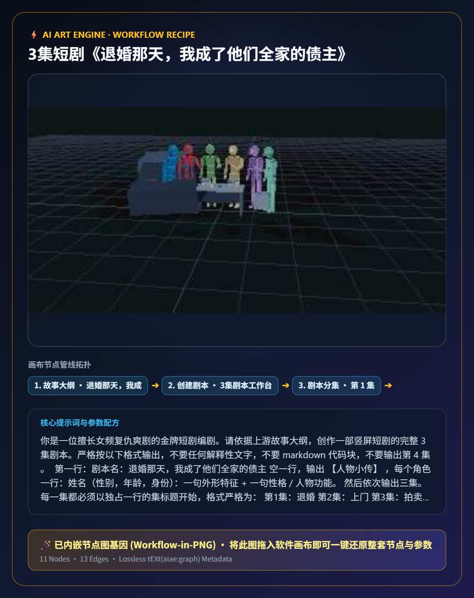
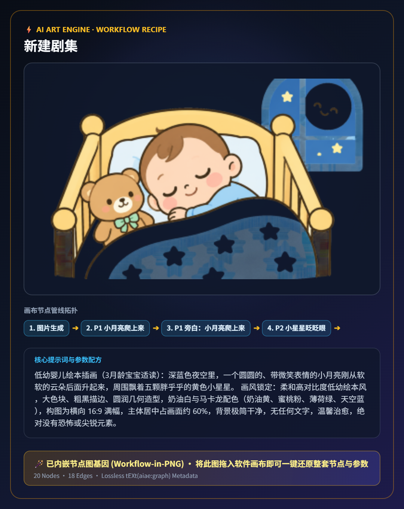
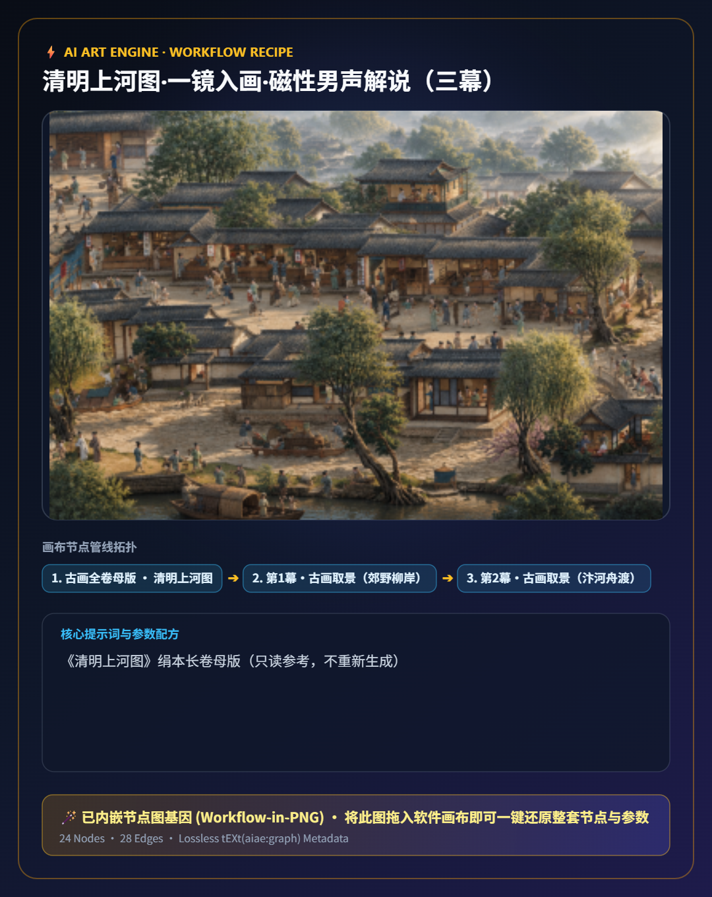
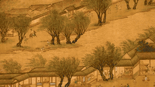

<div align="center">

<a href="https://justin-sky.github.io/ai-art-engine/index.en.html">
  
</a>

<h1>AI Art Engine</h1>

<p>
  <b>Make a wish. Get production-ready art assets.</b><br />
  <sub>The wish-driven AI art engine — say what you want, and an agent builds the workflow, drives the models, and delivers editable project files</sub>
</p>

<p>
  <a href="https://github.com/Justin-sky/ai-art-engine/releases"></a>
  <a href="https://github.com/Justin-sky/ai-art-engine/releases"></a>
  <a href="https://github.com/Justin-sky/ai-art-engine/stargazers"></a>
  <a href="./LICENSE"></a>
  
</p>

<p>
  <a href="https://justin-sky.github.io/ai-art-engine/index.en.html"><b>🌐 Website</b></a> ·
  <a href="https://justin-sky.github.io/ai-art-engine/quickstart.en.html"><b>🚀 Quickstart</b></a> ·
  <a href="https://justin-sky.github.io/ai-art-engine/manual.en.html"><b>📖 Manual</b></a> ·
  <a href="https://space.bilibili.com/3707036976024122"><b>🎬 Video Tutorials</b></a> ·
  <a href="https://github.com/Justin-sky/ai-art-engine/releases"><b>⬇️ Download</b></a> ·
  <a href="./CHANGELOG.md"><b>📝 Changelog</b></a> ·
  <a href="./README.md"><b>中文</b></a>
</p>

</div>

---

## 🌠 Wish-Driven Generation: Describe the Outcome, Not the Steps

Making game art used to mean: pick a model → tune parameters → wire nodes → cut out → split layers → fix text → export → redo…

In AI Art Engine, you do just one thing — **make a wish**:

> 🙏 _"Give me a xianxia-style inventory UI, split into a PSD with editable text, and export Unity code too."_

And here is how the wish comes true:

```
Your wish ─▶ Agent understands intent ─▶ Builds a workflow on the canvas ─▶ Drives models & local vision ─▶ Delivers an editable project
```

When the wish is granted, you get **not a picture, but a project that drops straight into your pipeline**:

| Your wish                                                 | What you get                                                |
| :-------------------------------------------------------- | :---------------------------------------------------------- |
| _"Split this UI screenshot into a pro-grade layered PSD"_ | Control-level layers, editable text `.psd` + engine UI code |
| _"Bring this character illustration to life"_             | A rigged, animated Spine project                            |
| _"Shoot this script as a one-minute short drama"_         | Final MP4 + an editable CapCut / Jianying draft             |

---

## 🧪 Wish Recipe: Full Pipeline in a Single PNG (Workflow-in-PNG)

Every granted wish can be exported as a **Recipe Card (`.png`)** carrying lossless `tEXt(aiae:graph)` metadata. Drag the original PNG back onto the canvas to restore the entire node topology, 3D Director Stage previz, and prompt parameters in one step:

<div align="center">
<table>
  <tr>
    <th align="center">🪄 Workflow Recipe (Click for Original PNG)</th>
    <th align="center">🎬 Generated Output (Click for HD Video with Audio)</th>
  </tr>
  <tr>
    <td align="center" valign="middle">
      <a href="website/assets/recipe/recipe1.png" target="_blank">
        
      </a>
      <br />
      <sub><b>Recipe 1 · 3D Previz & Short Drama</b> (11 Nodes)<br />🔍 <a href="website/assets/recipe/recipe1.png" target="_blank">View / download original PNG</a></sub>
    </td>
    <td align="center" valign="middle">
      <a href="https://justin-sky.github.io/ai-art-engine/assets/recipe/recipe1.mp4" target="_blank">
        
      </a>
      <br />
      <sub>🔊 <a href="https://justin-sky.github.io/ai-art-engine/assets/recipe/recipe1.mp4" target="_blank">Play HD MP4 with audio</a></sub>
    </td>
  </tr>
  <tr>
    <td align="center" valign="middle">
      <a href="website/assets/recipe/recipe2.png" target="_blank">
        
      </a>
      <br />
      <sub><b>Recipe 2 · Narrated Children's Storybook</b> (20 Nodes)<br />🔍 <a href="website/assets/recipe/recipe2.png" target="_blank">View / download original PNG</a></sub>
    </td>
    <td align="center" valign="middle">
      <a href="https://justin-sky.github.io/ai-art-engine/assets/recipe/recipe2.mp4" target="_blank">
        
      </a>
      <br />
      <sub>🔊 <a href="https://justin-sky.github.io/ai-art-engine/assets/recipe/recipe2.mp4" target="_blank">Play HD MP4 with audio</a></sub>
    </td>
  </tr>
  <tr>
    <td align="center" valign="middle">
      <a href="website/assets/recipe/recipe3.png" target="_blank">
        
      </a>
      <br />
      <sub><b>Recipe 3 · Ancient Scroll Revival (Qingming Scroll)</b> (24 Nodes)<br />🔍 <a href="website/assets/recipe/recipe3.png" target="_blank">View / download original PNG</a></sub>
    </td>
    <td align="center" valign="middle">
      <a href="https://justin-sky.github.io/ai-art-engine/assets/recipe/recipe3.mp4" target="_blank">
        
      </a>
      <br />
      <sub>🔊 <a href="https://justin-sky.github.io/ai-art-engine/assets/recipe/recipe3.mp4" target="_blank">Play HD MP4 with audio</a></sub>
    </td>
  </tr>
</table>
</div>

---

## ✨ Why Wishes Come True Here

**🧭 A wish is never a black box.**
Every wish becomes a **visible, editable** node workflow on the canvas. Don't like a step? Tweak one node or add one more sentence — only the changed parts re-run. Granted wishes are embedded into output PNGs; drop one back on the canvas to reproduce it.

**📦 Wishes land as projects, not dead images.**
Our bar: a professional artist or engineer can pick it up and keep working. Layered, text-editable, state-aware, engine-ready — not a flat image you can only regenerate.

**🔓 Wish upon any model.**
Switch freely among 30+ cloud models and local ComfyUI / Ollama. Bring your own key, local-first; a project is just a plain folder on your disk. Built-in offline OCR and local vision models grant many wishes even offline.

**🧩 The wishing well keeps growing.**
Skills from the [Marketplace](./docs/MARKETPLACE.md) teach the agent new kinds of wishes; via MCP, Claude Code / Codex / Cursor can make wishes on your behalf.

---

## 🙏 The Wish Maiden


Every time you make a wish, the Wish Maiden above the chat folds her hands and prays for you:

> _"No errors! Never red!"_ · _"First try · all green"_ · _"Spend less · save tokens"_

Luck points float up from her head like game damage numbers — poke her and you might land a **critical hit**. When the wish is granted, she'll be even happier than you: _"✌️ Wish Granted! All Green!"_

Of course, what really grants the wish isn't luck — it's the agent and the workflow behind it. 😉

<br clear="right" />

---

## 🚀 Make Your First Wish in 3 Minutes

1. **Install**: Grab an installer from [Releases](https://github.com/Justin-sky/ai-art-engine/releases) (Windows `.exe` · macOS `.dmg` · Linux `.AppImage`). Works out of the box.
2. **Zero-key trial**: Create a project, open **◈ AI Chat**, and click **⚡ Zero-Key Instant Demo** — watch a UI image turn into an editable PSD, no API key needed.
3. **Connect models**: Add any API key under **Settings → Models** (or connect local ComfyUI / Ollama), then tell the AI your wish.

👉 More in the [5-Minute Quickstart](https://justin-sky.github.io/ai-art-engine/quickstart.en.html) · [User Manual](https://justin-sky.github.io/ai-art-engine/manual.en.html)

<details>
<summary><b>🔌 Let Claude Code / Codex / Cursor make wishes for you (MCP)</b></summary>

<br />

The app starts an MCP server on `127.0.0.1` (port and token under **Settings → MCP**):

```bash
# stdio bridge
claude mcp add aiartengine -- node <install-or-repo-dir>/scripts/mcp-bridge.mjs

# or direct HTTP
claude mcp add --transport http aiartengine http://127.0.0.1:43110/mcp \
  --header "Authorization: Bearer <token>"

# optional: built-in Blender MCP modeling endpoint
claude mcp add --transport http blender http://127.0.0.1:43110/mcp/blender \
  --header "Authorization: Bearer <token>"
```

See the [MCP Reference](./docs/MCP.md).

</details>

<details>
<summary><b>🛠️ Build from Source</b></summary>

<br />

Requires **Node.js 22+**.

```bash
git clone https://github.com/Justin-sky/ai-art-engine.git
cd ai-art-engine
npm install
npm run dev     # dev mode with hot reload
npm test        # unit tests
npm run build   # build installers
```

Docs: [Architecture](./docs/ARCHITECTURE.md) · [Local Vision & Offline OCR](./docs/ARCH_YOLO_LOCAL.md) · [Graph Plugins](./docs/GRAPH_PLUGINS.md) · [Marketplace Spec](./docs/MARKETPLACE.md)

</details>

---

## 🤝 Community & License

Contributions are welcome ([`CONTRIBUTING.md`](./CONTRIBUTING.md)). GitHub is the primary repo; [Gitee](https://gitee.com/beijing_blue_whale_era_zhangjian/ai-art-engine) is a synced mirror.

<a href="https://github.com/Justin-sky/ai-art-engine/graphs/contributors">
  
</a>

- **QQ Groups**: `346340389` · `647306826` ｜ [Bilibili](https://space.bilibili.com/3707036976024122) ｜ [X @IoKKFOvWAt12669](https://x.com/IoKKFOvWAt12669) ｜ [284139554@qq.com](mailto:284139554@qq.com)
- **License**: [GPL-3.0](./LICENSE)
