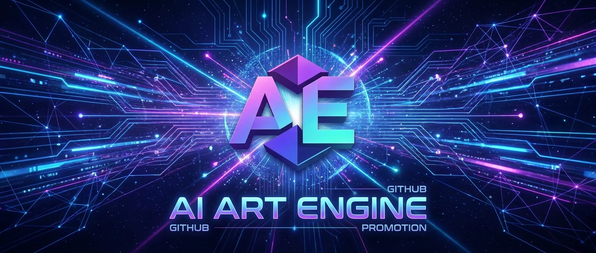
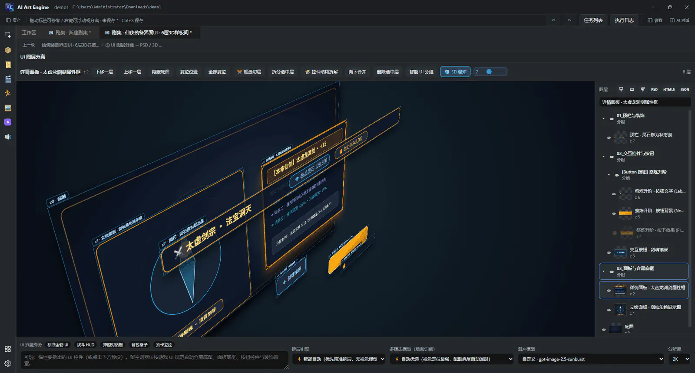
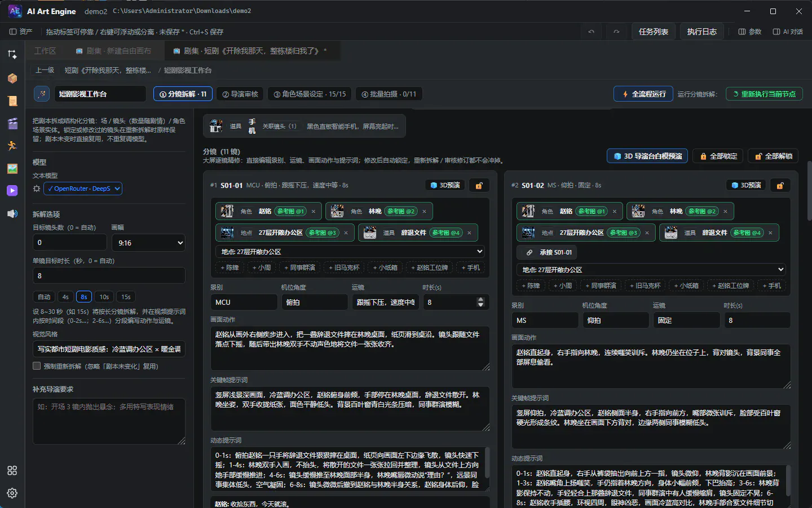
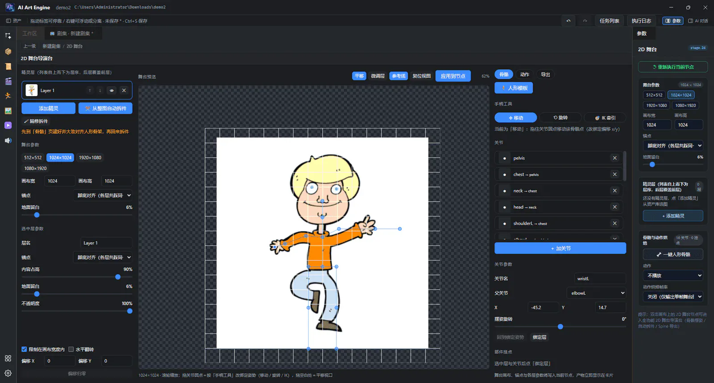
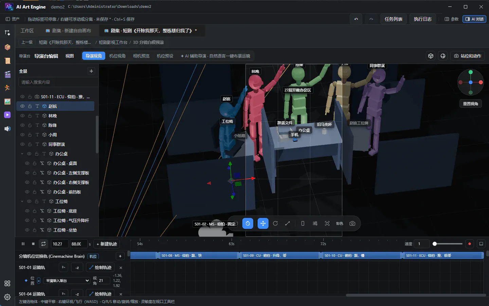
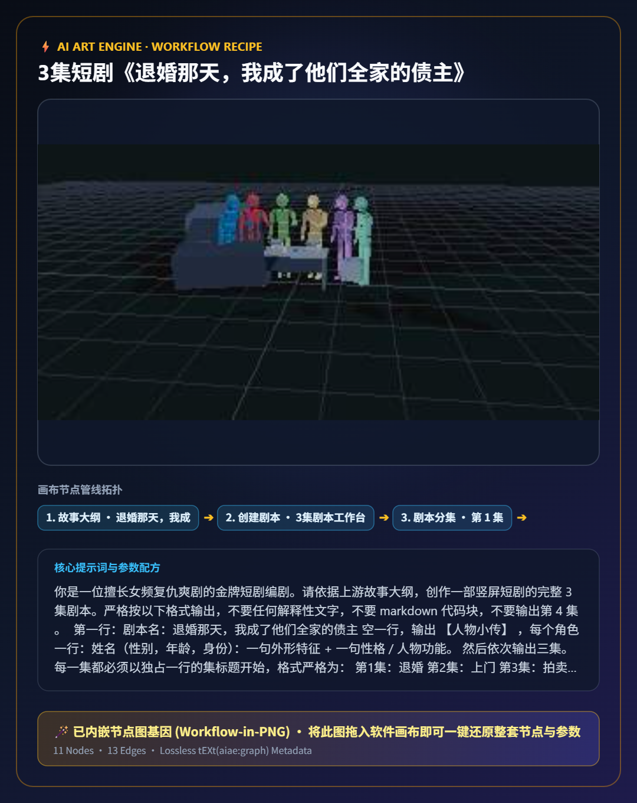
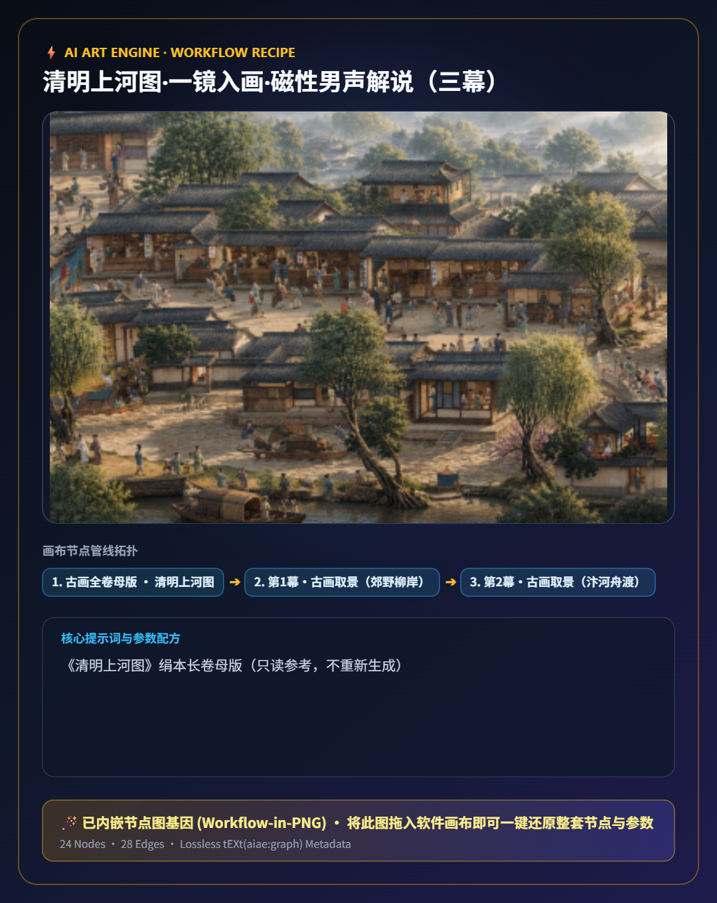

<div align="center">

<a href="https://justin-sky.github.io/ai-art-engine/index.en.html">
  
</a>

<h1>AI Art Engine</h1>

<p>
  <b>Make a wish. Ship production-ready game & media engineering files.</b><br />
  <sub>
    <b>Open-Source · Local-First · Agent-Native (102 MCP Tools) Multimodal AI Creative & Game Asset Engine</b><br />
    Stop settling for flat dead images — deliver <b>layered editable PSDs (native <code>TySh</code> text)</b>, <b>Unity / Godot 4 UI code</b>, <b>Spine 2D rigs</b>,<br />
    <b>Machinations game economy sandboxes</b>, <b>AI short dramas + CapCut NLE drafts</b>, <b>Blender / 3D assets</b>, and <b>playable HTML5 games</b>
  </sub>
</p>

<p>
  <a href="https://github.com/Justin-sky/ai-art-engine/releases"></a>
  <a href="https://github.com/Justin-sky/ai-art-engine/releases"></a>
  <a href="https://github.com/Justin-sky/ai-art-engine/stargazers"></a>
  <a href="./docs/MCP.md"></a>
  <a href="./docs/ARCH_YOLO_LOCAL.md"></a>
  <a href="./LICENSE"></a>
  
</p>

<p>
  <a href="https://justin-sky.github.io/ai-art-engine/index.en.html"><b>🌐 Website</b></a> ·
  <a href="https://justin-sky.github.io/ai-art-engine/quickstart.en.html"><b>🚀 5-Min Quickstart</b></a> ·
  <a href="https://justin-sky.github.io/ai-art-engine/manual.en.html"><b>📖 User Manual</b></a> ·
  <a href="https://justin-sky.github.io/ai-art-engine/guide-mcp.en.html"><b>🔌 MCP Guide</b></a> ·
  <a href="https://space.bilibili.com/3707036976024122"><b>🎬 Video Tutorials</b></a> ·
  <a href="https://github.com/Justin-sky/ai-art-engine/releases"><b>⬇️ Download</b></a> ·
  <a href="./CHANGELOG.md"><b>📝 Changelog</b></a> ·
  <a href="./README.md"><b>简体中文</b></a>
</p>

</div>

---

## 🌠 What Is AI Art Engine? (From Flat AI Renders to Editable Production Pipelines)

Web-based AI generators hand you a **flat bitmap you cannot edit, re-letter, rig, or import into a game engine**. Raw node tools (like standalone ComfyUI) demand manual spaghetti wiring and lack **UI layer splitting, 2D/3D skeletal stages, game economy simulation, and multi-track NLE editing**.

**AI Art Engine** is an open-source, local-first desktop studio (Windows / macOS / Linux) uniting **Wish-Driven Agent Control**, a **Strongly-Typed Multimodal DAG Canvas**, and **10+ Specialized Dive Workbenches**:

```text
Your Wish ─▶ Agent builds DAG workflow & drives 30+ Cloud/Local Models + Offline Vision ─▶ Dive into Studio Workbenches ─▶ Ship Editable Engineering Files
```

| The Wish You Make in Chat                                                                       | The Production Deliverable You Ship                                                                                                                             |
| :---------------------------------------------------------------------------------------------- | :-------------------------------------------------------------------------------------------------------------------------------------------------------------- |
| **_"Split this RPG inventory UI into an editable PSD and export Unity & Godot code"_**          | 16 UI control classes + inpainted 9-slice plates + **`.psd` with native Photoshop `TySh` editable text layers** + **Unity UXML/UGUI · Godot 4 `.tscn` · HTML5** |
| **_"Assemble a login modal from my UI sprite atlas slices"_**                                   | Zero-hallucination deterministic pixel assembly (`ui.atlasCompose`) + grouped `.psd`                                                                            |
| **_"Bring this 2D anime character illustration to life for our game"_**                         | AI bone alignment + part cutting & edge inpainting + **Spine 2D (`skeleton.json` + `.atlas`)** + sprite sheets                                                  |
| **_"Design a gacha pity / tower-defense economy loop and balance its curve"_**                  | **Machinations system-dynamics sandbox** + Monte Carlo P10/P50/P90 bands + **120fps Bezier curve-drag Goal-Seek solver** + **Unity C# / Godot GDScript**        |
| **_"Produce a 1-minute cyberpunk short drama with locked character faces and a CapCut draft"_** | 21-genre 5-stage Film Workbench (`@1`–`@4` anchor lock + 3D white-box camera previz + TTS voiceover) → **MP4 + CapCut / Jianying multi-track draft**            |
| **_"Reverse-engineer this viral video's pacing and remake it with our product"_**               | 2-node `rea-video` 4-axis audio-visual forensic breakdown + clean-plate text removal + DP batched remake + ASS kinetic subtitles                                |
| **_"Model a low-poly floating shrine in Blender and import the GLB"_**                          | Direct **Blender MCP** `bpy` modeling, multi-angle viewport verification, and `.glb` / `.fbx` asset import                                                      |
| **_"Build a playable 3D roguelike arena prototype from one sentence"_**                         | Self-contained **`single.html`** with procedural meshes, Canvas textures & WebAudio SFX (verified by headless browser frame-diff smoke tests)                   |

---

## ⚔️ Why AI Art Engine? (Comparison)

| Dimension                   | Web AI Image / Video Generators       | Raw Node Graphs (e.g. bare ComfyUI)     | **AI Art Engine (This Repo)**                                                                                                              |
| :-------------------------- | :------------------------------------ | :-------------------------------------- | :----------------------------------------------------------------------------------------------------------------------------------------- |
| **Interaction Model**       | Black-box prompt slot machine         | Manual node hunting & complex wiring    | **Natural-language wishes build editable DAG graphs** (+ **⚡ Zero-Key Instant Demo**)                                                     |
| **Output Formats**          | Flat PNG / single MP4 clip            | Raw tensors / flat media files          | **Native `TySh` PSD · Unity/Godot UI · Spine 2D · CapCut Drafts · C#/GDScript · GLB · Playable HTML5**                                     |
| **Interactive Sub-Studios** | None (or basic brush inpaint)         | Parameter forms only                    | **Double-click to Dive into 10+ full-screen studios** (3D Exploded UI, 5-Stage Film, 3D Director, 6-Tab NLE, Wavelet Portrait, Comic Page) |
| **Game Economy & Balance**  | Not supported                         | Not supported                           | **Built-in Machinations-aligned Studio**: 59 standard building blocks, playable card HUD, **120fps curve-drag inverse Goal-Seek**          |
| **External Agent / MCP**    | Closed web UI                         | Fragmented community scripts            | **Built-in `127.0.0.1` bi-directional MCP Server (102 tools)** — drive everything from Claude Code, Cursor, Codex & Blender                |
| **Privacy & Cost**          | Cloud lock-in & monthly subscriptions | Local-only, lacks unified cloud routing | **100% local multi-project workspaces + BYOK (30+ cloud + ComfyUI/Ollama) + free GPU offline ONNX vision & native OCR**                    |

---

## 🔥 8 Flagship Engineering Capabilities

### 1. 🎮 Game UI Layer Split & Atlas Compose → Native `TySh` PSD + Multi-Engine Code

<p align="center">
  
</p>

- **16-Class Game UI Decomposition (`image.layerSplit`)**: Combines cross-platform native offline OCR (Windows WinRT / macOS Vision / Linux Tesseract) with VLM layout-tree parsing to isolate 16 standard UI control types, sample text fill/stroke colors, inpaint clean **9-slice background plates**, and inspect hierarchy in a **3D Holographic Exploded View**.
- **Deterministic UI Atlas Assembly (`ui.atlasCompose`)**: Wire existing UI sprites or shared component libraries to assemble full UI screens with **zero pixel hallucination**.
- **Engine-Ready Exports**: One-click export to nested-group **`.psd` with native Photoshop `TySh` editable text layers**, plus **Unity UI Toolkit (`.uxml/.uss`), Unity UGUI (C#), Godot 4 (`.tscn`), and HTML5**.

### 2. ⚖️ Machinations Game Economy & Balance Sandbox (59 Building Blocks + 120fps Curve-Drag Goal-Seek)

- **100% Machinations System-Dynamics Alignment (`game.economy`)**: Full support for 10 node primitives (`Source`, `Pool`, `Converter`, `Drain`, `Gate`, `Trader`, `Register`, `Delay`, `Queue`, `End`), 8 state-edge modifiers, color filters, and `FIFO / LIFO / Shuffle` pool policies — plus **59 simulation-verified building blocks** (gacha soft/hard pity, armor mitigation, idle loops, RPG XP curves) with collision-free variable remapping.
- **Lossless Simple ↔ Pro Macros & Zero-Code Playable Card Deck**: Collapse auxiliary sources/drains into clean macro properties and test mechanics immediately as an interactive **RPG HUD + clickable skill card prototype** (with AI auto-battler and seeded action macro replay).
- **120fps Bezier Slope Curve-Drag Inverse Solver**: Drag target bullseyes or bend the `◆ Slope Control Point` directly on the chart — the solver synthesizes `k * pow(STEP, p)` dynamic rate formulas, runs Monte Carlo P10/P50/P90 confidence bands & 2D sensitivity matrices, and exports crisp PNG / vector SVG / **Unity C# & Godot GDScript** runtime scripts.

### 3. 🎬 21-Genre 5-Stage AI Film Workbench · Forensic Video Remake · CapCut Draft Export

<p align="center">
  
</p>

- **5-Stage Episodic Pipeline (`film.workbench`)**: Ships with **21 proven short-drama / comic-drama genre blueprints (P01–P21)** orchestrating **① Breakdown (first-frame + timed motion beats) → ② 11-Point Continuity & Dialogue Ratio Audit → ③ Cast/Scene/Prop/`STYLE01` Anchor Sheets & Cross-Episode Voice Binding → ④ `@1`–`@4` Identity-Locked Batch Render, Vision QC Auto-Reshoot & TTS → ⑤ Release Cover/Title Pack & Full Episode `.mp4`**. Fingerprint caching ensures **editing one shot only re-renders that shot**.
- **2-Node Forensic Video Breakdown & Remake (`semantic.analyze` → `semantic.rebuild`)**: 4-axis audio-visual forensics, 3-frame strip VLM perception, burned-subtitle clean-plate inpainting, DP optimal shot batching, lip-sync, and side-by-side `compare.mp4` output.
- **CapCut-Grade 6-Tab Multi-Track Timeline (`output.timeline`)**: 120+ GPU/FFmpeg synced effects, transitions, LUT filters, DOTween dual-layer keyframe tweens, and TD-PSOLA singing/pitch synthesis — exporting final MP4s or microsecond-accurate **CapCut / JianyingPro multi-track drafts**.

### 4. 🦴 2D AI Bone Alignment to Spine 2D & 4-Band Wavelet Portrait Studio

<p align="center">
  
</p>

- **2D Rigging Stage (`stage.2d`)**: Fuses anime Alpha-silhouette morphology with local `YOLOv8-Pose` keypoints for one-click **AI Bone Alignment & Part Cutting**, parent-child IK rigging, natural-language action presets (`idle`, `walk`, `attack`), sprite-sheet baking, and **Spine 2D (`skeleton.json` + `.atlas`)** export.
- **Commercial Portrait Retouch (`image.portrait`) & 10-in-1 Image Workbench (`image.process`)**: 4-band à-trous wavelet skin retouching (preserving micro-pores and bone lighting), 7 camera/film color sciences (Canon, Fujifilm Classic Neg., Leica M, Hasselblad HNCS, Kodak Portra 400), Procrustes 68-pt identity lock, feathered region compositing, and 10-spec ID photo print layouts.

### 5. 🎥 3D Director Stage × Live Blender MCP × World Labs 3D Gaussian Splatting

<p align="center">
  
</p>

- **3D Director Stage & Offscreen White-Box Previz (`director.stage`)**: 56-bone humanoid rig, **24 procedural motion clips**, 38 full-body/gaze presets, and Cinemachine camera tracks; renders per-shot `.webm` 3D white-box camera moves (`@2`) offscreen to lock downstream video camera trajectories.
- **Walkable Spatial Worlds & End-to-End 3D Ops**: Generate walkable 3D Gaussian Splatting worlds via **World Labs Marble** and export 600k-tri textured `.glb` meshes; run cloud **auto-rigging, animation retargeting, smart mesh segmentation, retopology & PBR texturing** (Meshy / Tripo / Rodin / Luma / Lux3D); or model live in Blender via the zero-dependency `/mcp/blender` bridge.

### 6. 🔌 Universal Agent Control & 102 Bi-Directional MCP Tools

- **100% Studio Capability Coverage over MCP**: On launch, the app serves **102 tools** (`93` on `/mcp` + `9` on `/mcp/blender`) over `127.0.0.1:43110` with persistent Bearer auth and JSONL audit logs — spanning multi-project workspaces, Git status/diff, runtime node introspection & `SmartPatch`, 3D Director control, Machinations curve solving, local offline OCR / YOLO / SAM 2.1 vision, NLE timeline editing, playable HTML5 game compilation, and 24h scheduled automations.
- **One Command for External Agents**: Connect Claude Code, Codex, Cursor, or Windsurf via stdio bridge or Streamable HTTP, guarded by per-request Ask / Plan / Craft access gates.

---

## 🧪 Workflow-in-PNG: Entire Pipelines Inside a Single Image

Every exported Recipe Card (`.png`) embeds its lossless `NodeGraphDocument` inside `iTXt/tEXt(aiae:graph)` metadata. **Download any original PNG below and drag it onto the AI Art Engine canvas to restore the entire node topology, 3D previz, and prompts in one step**:

<div align="center">
<table>
  <tr>
    <th align="center">🪄 Original Recipe PNG (Drag onto Canvas to Restore)</th>
    <th align="center">🎬 Generated Output (Click for HD MP4 with Audio)</th>
  </tr>
  <tr>
    <td align="center" valign="middle">
      <a href="website/assets/recipe/recipe1.png" target="_blank">
        
      </a>
      <br />
      <sub><b>Recipe 1 · 3D Previz & Episodic Short Drama</b> (11 Nodes)<br />🔍 <a href="website/assets/recipe/recipe1.png" target="_blank">View / download lossless Recipe PNG</a></sub>
    </td>
    <td align="center" valign="middle">
      <a href="https://justin-sky.github.io/ai-art-engine/assets/recipe/recipe1.mp4" target="_blank">
        
      </a>
      <br />
      <sub>🔊 <a href="https://justin-sky.github.io/ai-art-engine/assets/recipe/recipe1.mp4" target="_blank">Play HD MP4 with audio</a></sub>
    </td>
  </tr>
  <tr>
    <td align="center" valign="middle">
      <a href="website/assets/recipe/recipe2.png" target="_blank">
        
      </a>
      <br />
      <sub><b>Recipe 2 · Narrated Children's Storybook</b> (20 Nodes)<br />🔍 <a href="website/assets/recipe/recipe2.png" target="_blank">View / download lossless Recipe PNG</a></sub>
    </td>
    <td align="center" valign="middle">
      <a href="https://justin-sky.github.io/ai-art-engine/assets/recipe/recipe2.mp4" target="_blank">
        
      </a>
      <br />
      <sub>🔊 <a href="https://justin-sky.github.io/ai-art-engine/assets/recipe/recipe2.mp4" target="_blank">Play HD MP4 with audio</a></sub>
    </td>
  </tr>
  <tr>
    <td align="center" valign="middle">
      <a href="website/assets/recipe/recipe3.png" target="_blank">
        
      </a>
      <br />
      <sub><b>Recipe 3 · Ancient Scroll Revival (Living Painting + Lip-Sync)</b> (24 Nodes)<br />🔍 <a href="website/assets/recipe/recipe3.png" target="_blank">View / download lossless Recipe PNG</a></sub>
    </td>
    <td align="center" valign="middle">
      <a href="https://justin-sky.github.io/ai-art-engine/assets/recipe/recipe3.mp4" target="_blank">
        
      </a>
      <br />
      <sub>🔊 <a href="https://justin-sky.github.io/ai-art-engine/assets/recipe/recipe3.mp4" target="_blank">Play HD MP4 with audio</a></sub>
    </td>
  </tr>
</table>
</div>

---

## 🙏 The Wish Maiden (Vibe-Creating Companion)


Whenever you make a wish in the AI Chat panel, the **Wish Maiden** folds her hands above the session and prays for your pipeline:

> _"No errors! Never red!"_ · _"First try · all green"_ · _"Spend less · save tokens"_

Luck numbers float above her like RPG damage popups — poke her for a **golden critical hit**, while the canvas cycles through 10 procedural elemental weather atmospheres with synthesized pentatonic harp audio. When every node turns green, she celebrates right alongside you: _"✌️ Wish Granted! All Green!"_

Of course, what actually grants the wish is the **4-pillar runtime introspection bus, typed DAG executor, and local vision engine** underneath. 😉

<br clear="right" />

---

## 🚀 Quickstart in 3 Minutes

1. **Install**: Download the installer for your OS from [GitHub Releases](https://github.com/Justin-sky/ai-art-engine/releases) (Windows `.exe` · macOS Intel/Apple Silicon `.dmg` · Linux `.AppImage`). Bundled runtime — zero external dependencies.
2. **⚡ Zero-Key Instant Demo**: Create a workspace, open **◈ AI Chat** on the left, and click **⚡ Zero-Key Instant Demo** — inspect a 3D exploded Xianxia RPG UI and export a real layered `.psd` + Unity / Godot code with **no API key required**.
3. **Connect Your Models**: Under **Settings → Models**, add your own API keys (OpenRouter, OpenAI, Google Gemini / Veo 3.1, DeepSeek, xAI Grok, Volcengine Seedream/Seedance, Kling, MiniMax, Qwen, ElevenLabs, Meshy, Tripo, Rodin, World Labs, NewAPI — or local **ComfyUI / Ollama / vLLM / LM Studio**), then tell the AI your wish or install domain pipelines from the **Skill Marketplace**!

### 🔌 Connect Claude Code / Codex / Cursor via MCP

While AI Art Engine is running, its local MCP server listens on `127.0.0.1:43110` (view port & token in **Settings → MCP**):

```bash
# Option A: stdio bridge (recommended — auto-discovers port & persistent token)
claude mcp add aiartengine -- node <install-or-repo-dir>/scripts/mcp-bridge.mjs

# Option B: Direct Streamable HTTP (no local Node.js required)
claude mcp add --transport http aiartengine http://127.0.0.1:43110/mcp \
  --header "Authorization: Bearer <token>"

# Optional: Built-in Blender MCP live 3D modeling endpoint
claude mcp add --transport http blender http://127.0.0.1:43110/mcp/blender \
  --header "Authorization: Bearer <token>"
```

### 🛠️ Build & Run from Source

Requires **Node.js 22+**.

```bash
git clone https://github.com/Justin-sky/ai-art-engine.git
cd ai-art-engine
npm install
npm run dev      # Launch Electron dev mode with hot reload
npm test         # Run 550+ Vitest unit test suites
npm run site     # Preview official website & docs locally (http://localhost:5174)
npm run dist     # Package desktop installers
```

---

## 🗺️ Documentation Map

| For Creators (Official Site & Guides)                                                                                                                                                                                                                                                                                                                                                                                                         | For Engineers & Contributors (Repo Docs)                                                                                                  |
| :-------------------------------------------------------------------------------------------------------------------------------------------------------------------------------------------------------------------------------------------------------------------------------------------------------------------------------------------------------------------------------------------------------------------------------------------- | :---------------------------------------------------------------------------------------------------------------------------------------- |
| 🚀 [5-Minute Quickstart](https://justin-sky.github.io/ai-art-engine/quickstart.en.html)                                                                                                                                                                                                                                                                                                                                                       | 🏗️ [System Architecture & 4-Pillar Workspace Bus (`ARCHITECTURE.md`)](./docs/ARCHITECTURE.md)                                             |
| 📖 [Complete User Manual](https://justin-sky.github.io/ai-art-engine/manual.en.html) ([Setup](https://justin-sky.github.io/ai-art-engine/manual-setup.en.html) · [Workspace](https://justin-sky.github.io/ai-art-engine/manual-workspace.en.html) · [Workflows & Machinations](https://justin-sky.github.io/ai-art-engine/manual-workflow.en.html) · [Film & Director](https://justin-sky.github.io/ai-art-engine/manual-production.en.html)) | 🔌 [MCP Protocol & All 102 Tools (`MCP.md`)](./docs/MCP.md)                                                                               |
| 🎬 [AI Short-Drama & Film Guide](https://justin-sky.github.io/ai-art-engine/guide-short-video.en.html) · [Free-Canvas Video Guide](https://justin-sky.github.io/ai-art-engine/guide-video.en.html)                                                                                                                                                                                                                                            | 👁️ [Local ONNX Vision & Offline OCR (`ARCH_YOLO_LOCAL.md`)](./docs/ARCH_YOLO_LOCAL.md)                                                    |
| 🕹️ [Playable HTML5 Games from One Prompt](https://justin-sky.github.io/ai-art-engine/guide-gameplay.en.html)                                                                                                                                                                                                                                                                                                                                  | 🪪 [4-Band Wavelet Portrait Architecture (`PORTRAIT.md`)](./docs/PORTRAIT.md)                                                             |
| 🔗 [ComfyUI Integration](https://justin-sky.github.io/ai-art-engine/guide-comfyui.en.html) · [NewAPI Relay Gateway](https://justin-sky.github.io/ai-art-engine/guide-newapi.en.html)                                                                                                                                                                                                                                                          | 🧩 [Graph Plugin Spec (`GRAPH_PLUGINS.md`)](./docs/GRAPH_PLUGINS.md) · [Skill Marketplace Spec (`MARKETPLACE.md`)](./docs/MARKETPLACE.md) |
| 🤖 [External Agent MCP Setup](https://justin-sky.github.io/ai-art-engine/guide-mcp.en.html) · [Skill Publisher Docs](https://justin-sky.github.io/ai-art-engine/developers.en.html)                                                                                                                                                                                                                                                           | 💬 [AI Chat Harness Guide (`DEEPSEEK_HARNESS.md`)](./docs/DEEPSEEK_HARNESS.md) · [Roadmap (`ROADMAP.md`)](./docs/ROADMAP.md)              |

---

## ❓ Frequently Asked Questions (FAQ)

<details>
<summary><b>Q1: Is AI Art Engine completely free and open source? Do I need a dedicated GPU?</b></summary>
<br />
Yes — released under <b>GPL-3.0</b> with no login wall, no subscription, and zero markup on your own API keys. Cloud generation needs <b>no dedicated GPU</b>; built-in local ONNX models (YOLO, SAM 2.1, RMBG, 468-pt FaceMesh) accelerate automatically over Windows DirectML, macOS CoreML, and Linux CUDA, with fast CPU fallback.
</details>

<details>
<summary><b>Q2: Are my project files or proprietary game assets uploaded to any server?</b></summary>
<br />
<b>100% local-first.</b> Workspaces, node graphs, and generated media live as plain folders and JSON files on your own disk — ready for Git. Pairing local ComfyUI / Ollama with built-in offline OCR and local ONNX vision enables <b>fully air-gapped offline production</b>.
</details>

<details>
<summary><b>Q3: Does UI Layer Split really export Photoshop PSDs with editable text layers?</b></summary>
<br />
Yes. <code>image.layerSplit</code> extracts text strings, bounds, fill colors, and stroke widths via offline/online OCR, inpaints clean underlying 9-slice plates, and writes native Photoshop <code>TySh</code> text descriptors inside nested layer groups — alongside Unity UXML/UGUI, Godot 4 <code>.tscn</code>, and HTML5 code.
</details>

<details>
<summary><b>Q4: How do game designers balance economies without writing code?</b></summary>
<br />
Describe your mechanic in AI Chat to generate a live <code>game.economy</code> Machinations node, drag from 59 standard building blocks, toggle between Simple Macro and Pro Blueprint views, or <b>drag resource curves directly on the chart</b> at 120fps to inverse-solve upstream rates and export C# / GDScript.
</details>

---

## 🤝 Community & License

Issues, feature ideas, and Pull Requests are warmly welcome (see [`CONTRIBUTING.md`](./CONTRIBUTING.md)). If AI Art Engine accelerates your game studio, film pipeline, or agent workflow, please consider giving the repo a **⭐ Star**!

- **Repositories**: [GitHub (Primary)](https://github.com/Justin-sky/ai-art-engine) ｜ [Gitee Mirror](https://gitee.com/beijing_blue_whale_era_zhangjian/ai-art-engine)
- **Community & Tutorials**: QQ Groups `346340389` · `647306826` ｜ [Bilibili @AIArtEngine](https://space.bilibili.com/3707036976024122) ｜ [X @IoKKFOvWAt12669](https://x.com/IoKKFOvWAt12669) ｜ Email [284139554@qq.com](mailto:284139554@qq.com)
- **License**: [GNU General Public License v3.0 (GPL-3.0)](./LICENSE)

<a href="https://github.com/Justin-sky/ai-art-engine/graphs/contributors">
  
</a>
