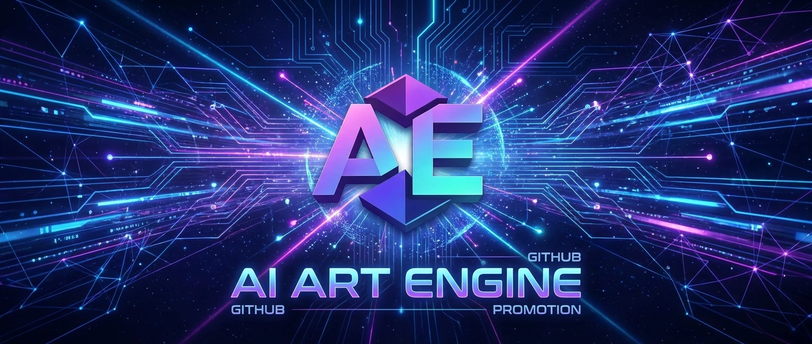
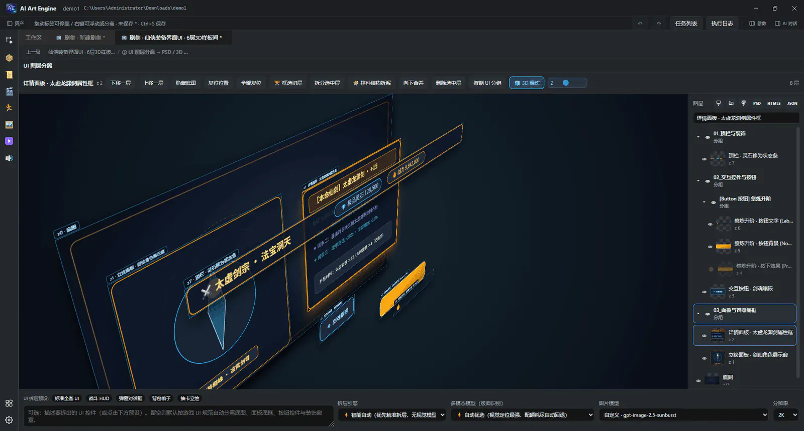
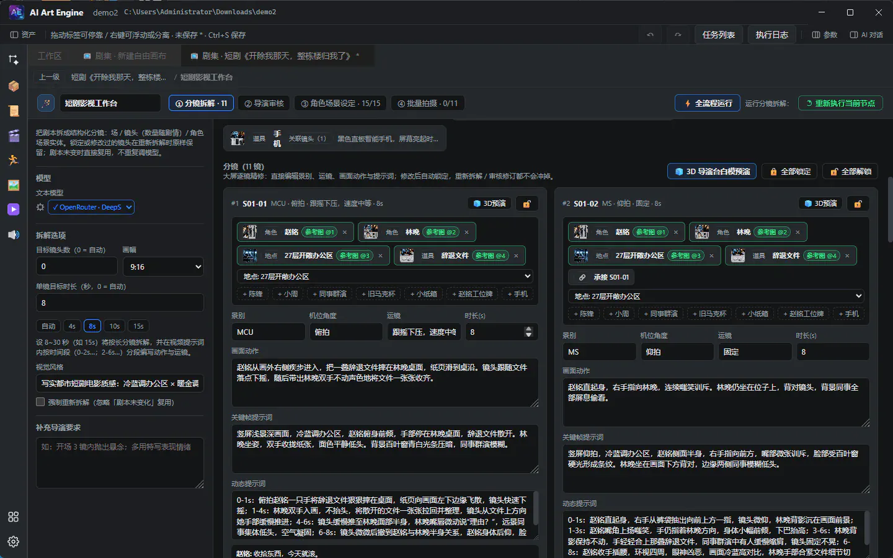
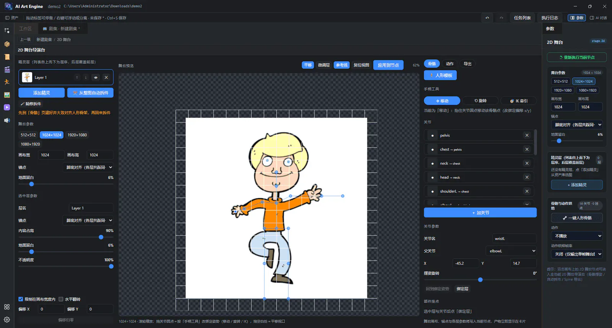
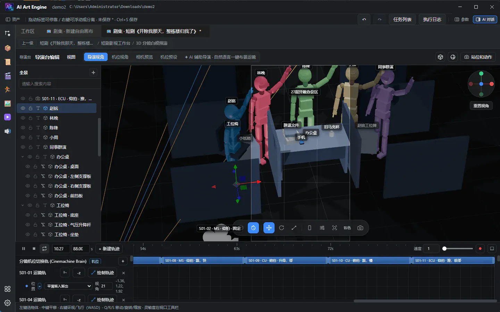
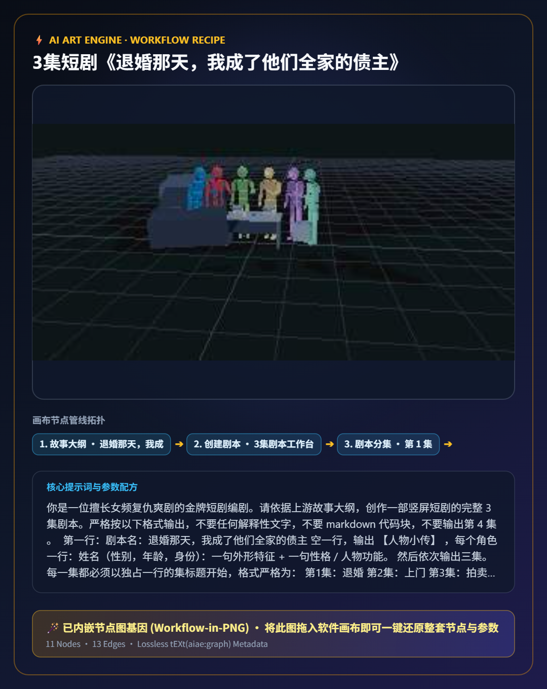
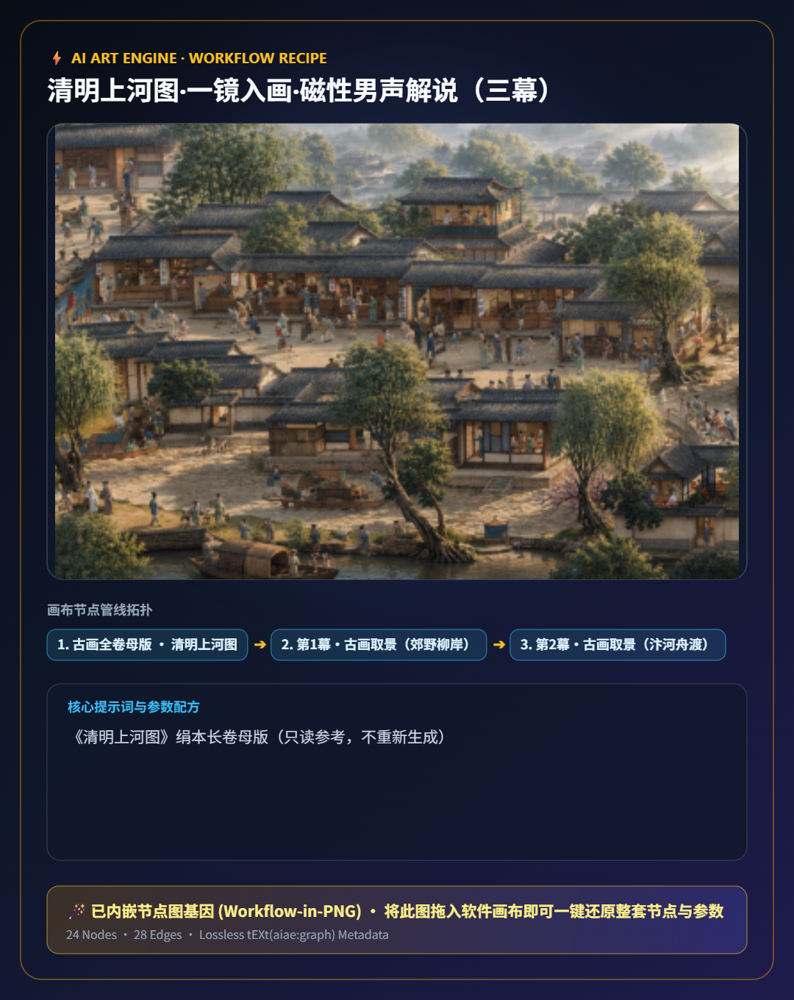

<div align="center">

<a href="https://justin-sky.github.io/ai-art-engine/">
  
</a>

<h1>AI Art Engine</h1>

<p>
  <b>许个愿，工业级美术与游戏工程就来了。</b><br />
  <sub>
    <b>开源 · 本地优先 · Agent 原生（102 MCP 工具）的全模态 AI 创作与工业资产引擎</b><br />
    不止生成扁平死图 —— 直接交付<b>原生可改字分层 PSD（<code>TySh</code>）</b>、<b>Unity / Godot 4 界面代码</b>、<b>Spine 2D 骨骼动画包</b>、<br />
    <b>Machinations 游戏数值沙盘</b>、<b>AI 漫剧短片与剪映多轨草稿</b>、<b>Blender / 3D 资产</b>与<b>单文件可玩 HTML5 游戏</b>
  </sub>
</p>

<p>
  <a href="https://github.com/Justin-sky/ai-art-engine/releases"></a>
  <a href="https://github.com/Justin-sky/ai-art-engine/releases"></a>
  <a href="https://github.com/Justin-sky/ai-art-engine/stargazers"></a>
  <a href="./docs/MCP.md"></a>
  <a href="./docs/ARCH_YOLO_LOCAL.md"></a>
  <a href="./LICENSE"></a>
  
</p>

<p>
  <a href="https://justin-sky.github.io/ai-art-engine/"><b>🌐 官方网站</b></a> ·
  <a href="https://justin-sky.github.io/ai-art-engine/quickstart.html"><b>🚀 5 分钟上手</b></a> ·
  <a href="https://justin-sky.github.io/ai-art-engine/manual.html"><b>📖 完整手册</b></a> ·
  <a href="https://justin-sky.github.io/ai-art-engine/guide-mcp.html"><b>🔌 MCP 接入</b></a> ·
  <a href="https://space.bilibili.com/3707036976024122"><b>🎬 B 站视频教程</b></a> ·
  <a href="https://github.com/Justin-sky/ai-art-engine/releases"><b>⬇️ 免费下载</b></a> ·
  <a href="./CHANGELOG.md"><b>📝 更新日志</b></a> ·
  <a href="./README.en.md"><b>English</b></a>
</p>

</div>

---

## 🌠 什么是 AI Art Engine？（从「AI 抽卡死图」到「可进管线的工程」）

传统 AIGC 网页工具给你一张**改不了字、分不了层、没法进引擎的扁平图片**；纯节点工具（如裸 ComfyUI）又需要手搓几十根连线，且缺少**游戏 UI 拆层、2D/3D 骨骼、数值仿真与多轨剪辑工作台**。

**AI Art Engine** 是一套开源跨平台桌面引擎（Windows / macOS / Linux），把 **「许愿式 Agent 对话直控」**、**「强类型多模态 DAG 节点画布」** 与 **「10+ 专业 Dive 精修工作台」** 合而为一：

```text
你的自然语言愿望 ─▶ Agent 自动编排节点图 & 调度 30+ 云端/本地模型 + 离线视觉 ─▶ 双击节点潜入专业工作台精修 ─▶ 交付可编辑工业工程
```

| 你在对话里许下的愿望                                                     | 直接交付给美术 / 策划 / 程序的工业产物                                                                                           |
| :----------------------------------------------------------------------- | :------------------------------------------------------------------------------------------------------------------------------- |
| **「把这张游戏界面图拆成可改字的分层 PSD，顺便出 Unity 和 Godot 代码」** | 16 类标准控件分层 + 九宫格干净底板 + **原生 Photoshop `TySh` 可双击改字 `.psd`** + **Unity UXML/UGUI · Godot 4 `.tscn` · HTML5** |
| **「用工程里的 UI 图集切图拼一套登录弹窗界面」**                         | 零幻觉保留原始像素的确定性拼装界面（`ui.atlasCompose`）+ 分层 `.psd`                                                             |
| **「让这张二次元立绘动起来，导出能进游戏的骨骼包」**                     | AI 自动识骨对齐 + 部件拆切扩边补全 + **Spine 2D（`skeleton.json` + `.atlas`）** + 透明精灵图集                                   |
| **「设计一套抽卡软硬保底 / 塔防经济机制，按期望曲线配平数值」**          | **Machinations 系统动力学沙盘** + 蒙特卡洛 P10/P50/P90 曲线 + **120fps 贝塞尔曲线拖拽反推公式** + **Unity C# / Godot GDScript**  |
| **「按女频古风爽剧拍一集一分钟漫剧，锁死主角长相并导出剪映草稿」**       | 21 题材五阶段影视工作台（`@1`–`@4` 锚点锁脸 + 3D 白模运镜预演 + 角色 TTS 配音）→ **MP4 成片 + 剪映 / CapCut 多轨草稿包**         |
| **「拆解这条爆款短视频的分镜和包装，换成我的产品重拍一条」**             | 双节点 `rea-video` 四轴视听取证拆解报告 + 去花字底板 + 动态规划合批重制成片 + ASS 动态字幕                                       |
| **「用 Blender 搭一座低多边形浮空岛，贴好材质导成 GLB 入库」**           | 直连本机 **Blender MCP** 自动执行 `bpy` 建模、多视角截图自检并导出 `.glb` / `.fbx`                                               |
| **「一句话做个可玩的 3D 肉鸽射击小游戏」**                               | 程序化合成美术与 WebAudio 音效的单文件 **`single.html`**（通过无头浏览器帧差分冒烟门禁验证）                                     |

---

## ⚔️ 为什么选择 AI Art Engine？（横向对比）

| 维度                      | 传统网页 AI 生图 / 视频站               | 纯节点连线工具（如裸 ComfyUI）        | **AI Art Engine（本项目）**                                                                                     |
| :------------------------ | :-------------------------------------- | :------------------------------------ | :-------------------------------------------------------------------------------------------------------------- |
| **上手与操控方式**        | 只能写提示词反复抽卡，黑盒不可控        | 需手动搜节点、排几十根连线，门槛高    | **一句话许愿自动建图 + 画布节点可视化微调**（内置 **⚡ 零 Key 极速体验**）                                      |
| **最终交付格式**          | 扁平 PNG / 单段 MP4（改一个字都要重抽） | 图像 / 视频张量输出，无下游工业导出器 | **原生 `TySh` 分层 PSD · Unity/Godot UI · Spine 2D · 剪映草稿 · C#/GDScript · GLB · 可玩 HTML5**                |
| **专业精修子工作台**      | 无（或仅简单涂抹重绘）                  | 无（纯参数面板）                      | **双击节点潜入 10+ 全屏 Dive 工作台**（UI 爆炸拆层、五阶段漫剧、3D 导演台、6 栏剪辑时间线、小波人像、条漫排版） |
| **游戏机制与数值平衡**    | 不支持                                  | 不支持                                | **内置 Machinations.io 100% 机制对齐沙盘**：59 款标准积木、一键卡片试玩台、**120fps 折线拖拽逆向反推配平**      |
| **外部 Agent / MCP 生态** | 封闭网页，无法被编程 Agent 调用         | 需额外拼凑第三方脚本，能力碎片化      | **内置 `127.0.0.1` 双向 MCP 服务（102 个工具全覆盖）**，Claude Code / Cursor / Codex + Blender 一行命令接管     |
| **数据隐私与使用成本**    | 素材强制上云、按月订阅抽成              | 本地开源，但缺统一多厂商云端路由      | **100% 本地多工程工作区 + 自带 API Key（30+ 云端 + 本地 ComfyUI/Ollama）+ 免费 GPU 离线视觉与原生 OCR**         |

---

## 🔥 八大核心技术亮点

### 1. 🎮 游戏 UI 精准拆层与图集拼装 → 原生 `TySh` 可改字 PSD + 多引擎代码

<p align="center">
  
</p>

- **16 类标准游戏 UI 控件识别（`image.layerSplit`）**：结合跨平台本地离线 OCR（Windows WinRT / macOS Vision / Linux Tesseract）与多模态大模型版面树解析，精准剥离按钮、弹窗、货币栏、背包格、血条等 16 类控件，自动采样字芯色与描边色、抹除文字补全**九宫格（9-Slice）干净底板**，并在 **3D 全息爆炸视图**中检视层级。
- **确定性图集拼装（`ui.atlasCompose`）**：直接输入工程内 UI 切图或共享组件库，**零幻觉 100% 保留原始像素**组装完整游戏界面。
- **真正可进管线的交付**：一键导出保留二级嵌套文件夹与 **Photoshop 原生 `TySh` 可双击修改文字层**的 `.psd`，同步生成 **Unity UI Toolkit（`.uxml/.uss`）、Unity UGUI（C#）、Godot 4（`.tscn`）与响应式 HTML5** 代码。

### 2. ⚖️ Machinations 游戏机制与数值仿真沙盘（59 款标准积木 + 120fps 曲线拖拽反推）

- **100% Machinations 系统动力学对齐（`game.economy`）**：完整支持 `Source / Pool / Converter / Drain / Gate / Trader / Register / Delay / Queue / End` 10 类图元、8 类状态修饰符、多色过滤器与 `FIFO / LIFO / Shuffle` 池策略；内置 **59 款经仿真验证的官方级数值积木**（抽卡软硬保底、护甲减伤、放置产线、RPG 成长等），拖入同画布自动重映射变量零冲突拼装。
- **极简创造 ↔ 专业蓝图无损互转 & 零代码卡片试玩台**：一键将复杂外围源漏折叠为内聚宏属性，并实时生成可点击出牌的 **RPG 状态槽（HUD）+ 技能卡牌试玩台**（支持 AI 自动观战与同种子操作录制回归重放）。
- **120fps 贝塞尔斜率控制点拖拽反推（Curve Drag Goal-Seek）**：直接在折线图上按住上下拖动靶心或弯曲 `◆ 斜率控制点`（先慢后快指数 / 线性 / 先快后慢对数），引擎自动逆向求解上游参数并合成 `k * pow(STEP, p)` 动态速率公式，配合蒙特卡洛 P10/P50/P90 置信带、二维参数敏感度矩阵与一键导出高清 PNG / 矢量 SVG / **Unity C# & Godot GDScript** 经济脚本。

### 3. 🎬 AI 漫剧 21 题材五阶段影视工作台 · 视频逆向拆解重制 · 剪映草稿导出

<p align="center">
  
</p>

- **五阶段工业闭环（`film.workbench`）**：内置 **P01–P21 共 21 类爆款漫剧/短剧题材基因库**（黄金前 3 秒冷开场、爽点公式、断章钩子），一站式串联 **① 分镜拆解（A 段首帧 + B 段分秒动态拍点）→ ② 11 项连续性与对白占比审计 → ③ 角色/场景/道具/`STYLE01` 锚点定妆与跨集音色绑定 → ④ `@1`–`@4` 参考锁脸批量生图、视觉 QC 自动重拍、图生视频与 TTS 配音 → ⑤ 爆款标题封面发布包与整集 `.mp4` 合成**；内置指纹缓存，**改一镜只重算一镜**。
- **双节点 `rea-video` 视频逆向拆解与复刻（`semantic.analyze` → `semantic.rebuild`）**：内置四轴视听取证、三联帧多模态感知、首帧烧录花字净化、动态规划最优合批与口播对口型，支持高还原复刻与换品改编并直出 `compare.mp4` 对比片。
- **剪映级 6 栏成片时间线（`output.timeline`）**：内置 120+ 特效 / 转场 / 电影 LUT 滤镜 / DOTween 双层关键帧补间动画 / TD-PSOLA 人声移调歌唱合成，一键渲染 MP4 成片或导出微秒级对齐的 **剪映专业版 / CapCut 多轨可编辑草稿包**。

### 4. 🦴 2D 立绘 AI 识骨拆件导出 Spine & SOTA 四频段小波人像精修

<p align="center">
  
</p>

- **2D 骨骼舞台（`stage.2d`）**：融合二次元 Alpha 轮廓形态学扫描与本地 `YOLOv8-Pose` 关键点，一键完成 **「🤖 AI 识骨对齐 + 部件自动拆切扩边补全」**，内置父子骨骼、IK 约束与待机/行走/攻击等动作预设，直接烘焙透明序列帧、精灵图集与标准 **Spine 2D（`skeleton.json` + `.atlas`）** 工程包。
- **商业级人像精修（`image.portrait`）与 10 合 1 图像工作台（`image.process`）**：搭载 4 频段 à-trous 小波磨皮（保护真实微毛孔、保留骨相光影）、7 大单反/胶片色彩科学（佳能 / 富士 / 徕卡 / 哈苏 / Portra 400）、Procrustes 五官身份锁、局部羽化回贴与 10 规格证件照冲印排版。

### 5. 🎥 3D 导演台 × Blender MCP 实时建模 × World Labs 3D 高斯泼溅世界

<p align="center">
  
</p>

- **3D 导演台与分镜白模预演（`director.stage`）**：支持 56 根标准人形骨骼摆姿、**24 款程序化生活/战斗动作片段**、38 款全身/手势预设与 Cinemachine 多机位轨迹编排；可后台无头（Offscreen）按分镜自动录制 `.webm` 3D 白模运镜参考视频（`@2`）锁死下游视频生成运镜。
- **空间世界与全链路 3D 加工**：对接 **World Labs Marble** 文/图/视频生可漫游 3D 高斯泼溅世界（`.spz` / `.ply`）并导出 60 万面带贴图 `.glb`；支持 Meshy / Tripo / Rodin / Luma AI / Lux3D 的 **云端绑骨蒙皮、动画重定向、智能拆件、重拓扑与 PBR 贴图**；内置 `/mcp/blender` 零依赖直连本机 Blender 实时建模入库。

### 6. 🔌 全工作区 Agent 原生直控 & 102 个双向 MCP 工具全覆盖

- **内外同源的 102 个 MCP 工具**：应用启动即在 `127.0.0.1:43110` 开启带持久 Token 与审计日志的本地 MCP 服务（93 个主工具 + 9 个 Blender 工具），100% 覆盖多工程管理、Git 状态与 Diff、节点图自省与智能深层补丁（`SmartPatch`）、3D 导演台操控、Machinations 仿真反推、本地离线 OCR / YOLO / SAM2 视觉推理、时间线剪辑、可玩 HTML5 游戏编译（含无头浏览器冒烟自检）与 24 小时定时自动化任务。
- **一行命令接入外部编程 Agent**：Claude Code、Codex、Cursor、Windsurf 等可直接通过 stdio 桥或 Streamable HTTP 接管你的创作工程；内置 Ask / Plan / Craft 请求级安全权限闸门。

---

## 🧪 许愿配方：一张 PNG 复刻整条管线（Workflow-in-PNG）

在 AI Art Engine 中，每张导出的配方海报 `.png` 都通过 `iTXt/tEXt(aiae:graph)` 无损内嵌了完整的节点拓扑、3D 导演台预演与提示词基因。**下载下方任意原图并直接拖回软件画布，即可 1:1 还原整条生成管线**：

<div align="center">
<table>
  <tr>
    <th align="center">🪄 许愿配方原图（拖入画布一键还原工作流）</th>
    <th align="center">🎬 生成成片预览（点击观看有声高清 MP4）</th>
  </tr>
  <tr>
    <td align="center" valign="middle">
      <a href="website/assets/recipe/recipe1.png" target="_blank">
        
      </a>
      <br />
      <sub><b>配方 1 · 3D 预演与多集短剧管线</b>（11 节点）<br />🔍 <a href="website/assets/recipe/recipe1.png" target="_blank">查看 / 下载无损配方 PNG</a></sub>
    </td>
    <td align="center" valign="middle">
      <a href="https://justin-sky.github.io/ai-art-engine/assets/recipe/recipe1.mp4" target="_blank">
        
      </a>
      <br />
      <sub>🔊 <a href="https://justin-sky.github.io/ai-art-engine/assets/recipe/recipe1.mp4" target="_blank">点击播放有声高清 MP4 原视频</a></sub>
    </td>
  </tr>
  <tr>
    <td align="center" valign="middle">
      <a href="website/assets/recipe/recipe2.png" target="_blank">
        
      </a>
      <br />
      <sub><b>配方 2 · 儿童有声绘本短片</b>（20 节点）<br />🔍 <a href="website/assets/recipe/recipe2.png" target="_blank">查看 / 下载无损配方 PNG</a></sub>
    </td>
    <td align="center" valign="middle">
      <a href="https://justin-sky.github.io/ai-art-engine/assets/recipe/recipe2.mp4" target="_blank">
        
      </a>
      <br />
      <sub>🔊 <a href="https://justin-sky.github.io/ai-art-engine/assets/recipe/recipe2.mp4" target="_blank">点击播放有声高清 MP4 原视频</a></sub>
    </td>
  </tr>
  <tr>
    <td align="center" valign="middle">
      <a href="website/assets/recipe/recipe3.png" target="_blank">
        
      </a>
      <br />
      <sub><b>配方 3 · 清明上河图一镜入画（古画复活开口说话）</b>（24 节点）<br />🔍 <a href="website/assets/recipe/recipe3.png" target="_blank">查看 / 下载无损配方 PNG</a></sub>
    </td>
    <td align="center" valign="middle">
      <a href="https://justin-sky.github.io/ai-art-engine/assets/recipe/recipe3.mp4" target="_blank">
        
      </a>
      <br />
      <sub>🔊 <a href="https://justin-sky.github.io/ai-art-engine/assets/recipe/recipe3.mp4" target="_blank">点击播放有声高清 MP4 原视频</a></sub>
    </td>
  </tr>
</table>
</div>

---

## 🙏 祈愿仙子（Vibe Creating 陪伴系统）


每次你在对话面板许下愿望，会话上方的**祈愿仙子**就会双手合十替你祈福护航：

> 「不报错！绝不报红！」 · 「一次成功 · 遍地绿灯」 · 「少花钱 · 省点 Token」

欧气值会像 RPG 暴击数字一样从她头顶飘起，戳她一下还可能触发**金色暴击**；画布同时演化微风花语、祈愿星雨、地脉极光等 10 种动态自然天象与空灵五声竖琴音效。当全链路节点跑通绿灯时，她会比你更开心：「✌️ 许愿灵验！功德圆满！」

当然，真正让愿望每次灵验的不是玄学，而是底层的 **四支柱全工作区自省架构、强类型 DAG 执行器与本地视觉算力**。😉

<br clear="right" />

---

## 🚀 3 分钟快速上手

1. **下载安装**：前往 [GitHub Releases](https://github.com/Justin-sky/ai-art-engine/releases) 下载对应系统安装包（Windows `.exe` · macOS Intel/Apple Silicon `.dmg` · Linux `.AppImage`），内置独立运行时，开箱即用。
2. **⚡ 零 Key 极速体验**：新建工作区进入画布，打开左侧 **◈ AI 对话**，点击 **「⚡ 零 Key 极速体验」** —— 无需配置任何 API Key，即可体验「仙侠装备界面 3D 全息爆炸拆层 → 导出可改字 PSD 与 Unity / Godot 代码」。
3. **接入任意模型开始创作**：在 **设置 → 模型** 中填入你自己的 API Key（支持 OpenRouter、DeepSeek、OpenAI、Google Gemini / Veo 3.1、火山方舟 Seedream/Seedance、可灵 Kling、MiniMax、通义千问、智谱、Kimi、ElevenLabs、Meshy、Tripo、Rodin、World Labs、NewAPI，以及本机免费的 **ComfyUI / Ollama / vLLM / LM Studio**），直接向 AI 说出你的愿望，或从顶栏 **技能市场** 一键安装行业工作流！

### 🔌 让 Claude Code / Codex / Cursor 通过 MCP 接管创作

应用运行期间自动在本机 `127.0.0.1:43110` 启动 MCP 服务（连接配置与 Token 位于 **设置 → MCP 工具服务**）：

```bash
# 方式 A：stdio 桥接（推荐，自动读取本机端口与持久 Token）
claude mcp add aiartengine -- node <安装目录或仓库路径>/scripts/mcp-bridge.mjs

# 方式 B：Streamable HTTP 直连（无需本机安装 Node.js）
claude mcp add --transport http aiartengine http://127.0.0.1:43110/mcp \
  --header "Authorization: Bearer <token>"

# 可选：挂载内置 Blender MCP 实时 3D 建模端点
claude mcp add --transport http blender http://127.0.0.1:43110/mcp/blender \
  --header "Authorization: Bearer <token>"
```

### 🛠️ 从源码运行与二次开发

环境要求：**Node.js 22+**

```bash
git clone https://github.com/Justin-sky/ai-art-engine.git
cd ai-art-engine
npm install
npm run dev      # 启动 Electron 热重载开发模式
npm test         # 运行 Vitest 全量单元测试（550+ 测试套件）
npm run site     # 本地预览官网与完整手册 (http://localhost:5174)
npm run dist     # 构建生产环境安装包
```

---

## 🗺️ 文档导航与架构索引

| 面向创作者（官网手册与专题教程）                                                                                                                                                                                                                                                                                                                                                                         | 面向开发者与贡献者（仓库技术文档）                                                                                               |
| :------------------------------------------------------------------------------------------------------------------------------------------------------------------------------------------------------------------------------------------------------------------------------------------------------------------------------------------------------------------------------------------------------- | :------------------------------------------------------------------------------------------------------------------------------- |
| 🚀 [5 分钟快速上手](https://justin-sky.github.io/ai-art-engine/quickstart.html)                                                                                                                                                                                                                                                                                                                          | 🏗️ [系统架构与四支柱全工作区直控 (`ARCHITECTURE.md`)](./docs/ARCHITECTURE.md)                                                    |
| 📖 [完整使用手册](https://justin-sky.github.io/ai-art-engine/manual.html)（[设置](https://justin-sky.github.io/ai-art-engine/manual-setup.html) · [工作区](https://justin-sky.github.io/ai-art-engine/manual-workspace.html) · [节点图与数值沙盘](https://justin-sky.github.io/ai-art-engine/manual-workflow.html) · [影视与导演台](https://justin-sky.github.io/ai-art-engine/manual-production.html)） | 🔌 [MCP 协议与 102 个工具全集 (`MCP.md`)](./docs/MCP.md)                                                                         |
| 🎬 [AI 短剧与漫剧制作教程](https://justin-sky.github.io/ai-art-engine/guide-short-video.html) · [自由画布视频教程](https://justin-sky.github.io/ai-art-engine/guide-video.html)                                                                                                                                                                                                                          | 👁️ [本地 ONNX 视觉与跨平台离线 OCR (`ARCH_YOLO_LOCAL.md`)](./docs/ARCH_YOLO_LOCAL.md)                                            |
| 🕹️ [一句话生成可玩 HTML5 游戏](https://justin-sky.github.io/ai-art-engine/guide-gameplay.html)                                                                                                                                                                                                                                                                                                           | 🪪 [四频段小波人像精修架构 (`PORTRAIT.md`)](./docs/PORTRAIT.md)                                                                  |
| 🔗 [ComfyUI 本地接入教程](https://justin-sky.github.io/ai-art-engine/guide-comfyui.html) · [NewAPI 网关教程](https://justin-sky.github.io/ai-art-engine/guide-newapi.html)                                                                                                                                                                                                                               | 🧩 [节点图插件扩展规范 (`GRAPH_PLUGINS.md`)](./docs/GRAPH_PLUGINS.md) · [技能市场规范 (`MARKETPLACE.md`)](./docs/MARKETPLACE.md) |
| 🤖 [外部 Agent MCP 接入指南](https://justin-sky.github.io/ai-art-engine/guide-mcp.html) · [技能市场开发者文档](https://justin-sky.github.io/ai-art-engine/developers.html)                                                                                                                                                                                                                               | 💬 [AI 对话运行时指南 (`DEEPSEEK_HARNESS.md`)](./docs/DEEPSEEK_HARNESS.md) · [演进路线图 (`ROADMAP.md`)](./docs/ROADMAP.md)      |

---

## ❓ 常见问题（FAQ）

<details>
<summary><b>Q1：AI Art Engine 完全免费开源吗？需要独立显卡吗？</b></summary>
<br />
是的，软件基于 <b>GPL-3.0</b> 协议完全免费开源，无账号登录墙、无订阅费、不抽成 API 差价。调用云端模型时<b>无需独立显卡</b>，轻薄本即可流畅运行；内置的本地 ONNX 视觉模型（YOLO / SAM 2.1 / RMBG / 人脸网格）自动支持 Windows DirectML、macOS CoreML 与 Linux CUDA 硬件加速，在纯 CPU 下也可秒级推理。
</details>

<details>
<summary><b>Q2：工程文件和商业美术资产会上传到第三方服务器吗？</b></summary>
<br />
<b>100% 本地优先。</b>所有工作区、节点图 JSON 与生成媒体均以明文文件夹形式保存在你自己的硬盘上，随时可用 Git 管理或拷贝迁移。若连接本机 ComfyUI / Ollama 并使用内置离线 OCR 与本地抠图，可实现<b>全程断网不出内网</b>。
</details>

<details>
<summary><b>Q3：截图或 AI 生成的界面图，真的能拆成 Photoshop 可双击改字的 PSD 吗？</b></summary>
<br />
可以。<code>image.layerSplit</code> 节点通过离线/云端 OCR 提取文字内容、字号、字芯主色与描边粗细，自动将底层背景上的原文字迹无痕修补干净，再写入 Photoshop 原生 <code>TySh</code> 文本图层与二级嵌套图层组，设计师在 PS 中双击即可直接改字换字体，前端或客户端程序可同步拿到 Unity UXML/UGUI、Godot 4 <code>.tscn</code> 或 HTML5 代码。
</details>

<details>
<summary><b>Q4：游戏策划没有编程基础，怎么用内置 Machinations 沙盘调数值？</b></summary>
<br />
直接在 AI 对话里描述玩法（如「做一个每日体力恢复 + 普通/精英副本消耗的经济循环」），Agent 会自动生成可运行的 <code>game.economy</code> 节点；双击进入沙盘后，既可从 59 款标准积木抽屉拖拽拼装、切换「极简创造」视图，也可直接在折线图上<b>用鼠标上下拖动期望曲线或弯曲斜率控制点</b>，系统自动反推配平上游公式参数。
</details>

---

## 🤝 社区交流与开源许可

欢迎提交 Issue、功能建议与 Pull Request（参阅 [`CONTRIBUTING.md`](./CONTRIBUTING.md)）。如果这个项目帮到了你的游戏研发、漫剧创作或 Agent 工作流，欢迎点亮右上角 **⭐ Star** 支持我们！

- **代码仓库**：[GitHub 主仓库](https://github.com/Justin-sky/ai-art-engine) ｜ [Gitee 国内同步镜像](https://gitee.com/beijing_blue_whale_era_zhangjian/ai-art-engine)
- **交流与教程**：QQ 交流群 `346340389` · `647306826` ｜ [Bilibili 视频空间 @AIArtEngine](https://space.bilibili.com/3707036976024122) ｜ [X (Twitter)](https://x.com/IoKKFOvWAt12669) ｜ 邮箱 [284139554@qq.com](mailto:284139554@qq.com)
- **开源协议**：[GNU General Public License v3.0 (GPL-3.0)](./LICENSE)

<a href="https://github.com/Justin-sky/ai-art-engine/graphs/contributors">
  
</a>
