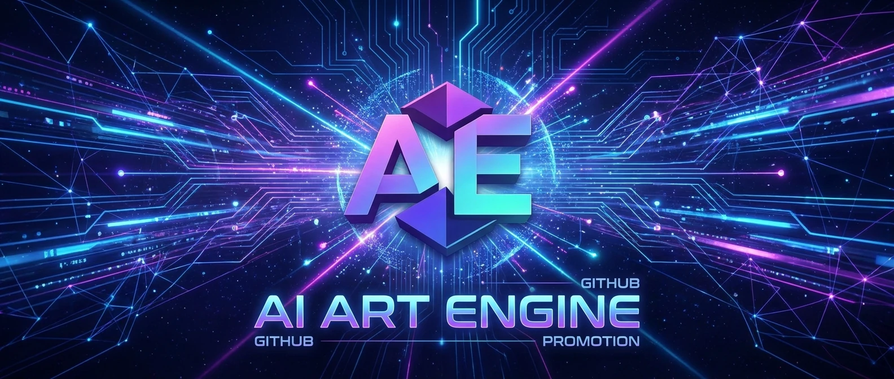

<div align="center">

<a href="https://justin-sky.github.io/ai-art-engine/">
  
</a>

<h1>AI Art Engine</h1>

<p>
  <b>许个愿，美术资产就来了。</b><br />
  <sub>许愿式 AI 美术引擎 —— 你只管说想要什么，Agent 替你搭流程、调模型、交付可编辑的工程文件</sub>
</p>

<p>
  <a href="https://github.com/Justin-sky/ai-art-engine/releases"></a>
  <a href="https://github.com/Justin-sky/ai-art-engine/releases"></a>
  <a href="https://github.com/Justin-sky/ai-art-engine/stargazers"></a>
  <a href="./LICENSE"></a>
  
</p>

<p>
  <a href="https://justin-sky.github.io/ai-art-engine/"><b>🌐 官方网站</b></a> ·
  <a href="https://justin-sky.github.io/ai-art-engine/quickstart.html"><b>🚀 5 分钟上手</b></a> ·
  <a href="https://justin-sky.github.io/ai-art-engine/manual.html"><b>📖 完整手册</b></a> ·
  <a href="https://space.bilibili.com/3707036976024122"><b>🎬 视频教程</b></a> ·
  <a href="https://github.com/Justin-sky/ai-art-engine/releases"><b>⬇️ 下载</b></a> ·
  <a href="./CHANGELOG.md"><b>📝 更新日志</b></a> ·
  <a href="./README.en.md"><b>English</b></a>
</p>

</div>

---

## 🌠 许愿式生成：说出愿望，而不是操作步骤

做一套游戏美术资产，过去要这样：挑模型 → 调参数 → 连节点 → 抠图 → 拆层 → 改字 → 导出 → 返工……

在 AI Art Engine 里，你只需要做一件事 —— **许愿**：

> 🙏 「给我一套仙侠风背包界面，拆成能直接改字的 PSD，顺便出 Unity 代码。」

然后愿望会这样被实现：

```
你的愿望 ─▶ Agent 理解意图 ─▶ 在画布上自动搭出工作流 ─▶ 调度模型与本地视觉算力 ─▶ 交付可编辑工程
```

愿望应验时，你拿到的**不是一张图，而是一份能直接进管线的工程**：

| 你许下的愿望                               | 你得到的                                           |
| :----------------------------------------- | :------------------------------------------------- |
| 「这张界面截图拆成专业美工水准的分层 PSD」 | 控件级分层、文字可双击修改的 `.psd` + 引擎 UI 代码 |
| 「这个立绘让她动起来」                     | 带骨骼与动作的 Spine 工程包                        |
| 「把这个剧本拍成一分钟短剧」               | MP4 成片 + 可二次精剪的剪映草稿                    |

---

## ✨ 为什么这里的愿望会「灵验」

**🧭 愿望不是黑箱。**
每个愿望都会被翻译成画布上**看得见、改得动**的节点工作流。哪一步不满意，点开改一个节点，或者再补一句话 —— 只重跑改动的部分。许过的愿还会存进产物 PNG，拖回画布即可完整复现。

**📦 愿望落地为「工程」，不是「死图」。**
我们的交付标准是：专业美术和程序员拿到就能接着干。分层、可改字、带状态、可导入引擎 —— 而不是一张只能重新生成的扁平图片。

**🔓 向任何模型许愿。**
30+ 云端模型与本地 ComfyUI / Ollama 自由切换，自带 Key、本地优先。工程就是你硬盘上的普通文件夹；内置离线 OCR 与本地视觉模型，很多愿望断网也能实现。

**🧩 愿望池会成长。**
[技能市场](./docs/MARKETPLACE.md)里的技能能教会 Agent 实现新类型的愿望；通过 MCP，Claude Code / Codex / Cursor 也可以替你许愿。

---

## 🙏 祈愿仙子


每次你许下愿望，会话上方的祈愿仙子就会双手合十替你祈祷：

> 「不报错！绝不报红！」「一次成功 · 遍地绿灯」「少花钱 · 省点 Token」

欧气值像游戏伤害数字一样从她头顶飘起，戳她一下还可能**暴击**。愿望应验时，她会比你更开心：「✌️ 许愿灵验！功德圆满！」

当然，真正让愿望灵验的不是玄学，而是背后的 Agent 与工作流。😉

<br clear="right" />

---

## 🚀 3 分钟许下第一个愿望

1. **下载安装**：前往 [Releases](https://github.com/Justin-sky/ai-art-engine/releases) 下载安装包（Windows `.exe` · macOS `.dmg` · Linux `.AppImage`），开箱即用。
2. **零 Key 试愿**：新建工程，打开左侧 **◈ AI 对话**，点击 **「⚡ 零 Key 极速体验」** —— 无需任何 API Key，即可看到一张界面图被拆成可编辑 PSD。
3. **接入模型**：在 **设置 → 模型** 中填入任一 API Key（或连接本机 ComfyUI / Ollama），然后对 AI 说出你的愿望（或通过工作区「新建」开启一键工作流）。

👉 更多玩法见 [5 分钟快速上手](https://justin-sky.github.io/ai-art-engine/quickstart.html) · [完整手册](https://justin-sky.github.io/ai-art-engine/manual.html) · [B 站视频教程](https://space.bilibili.com/3707036976024122)

<details>
<summary><b>🔌 让 Claude Code / Codex / Cursor 替你许愿（MCP）</b></summary>

<br />

应用启动后会在本机 `127.0.0.1` 开启 MCP 服务（端口与 Token 见「设置 → MCP 工具服务」）：

```bash
# stdio 桥接
claude mcp add aiartengine -- node <安装目录或仓库路径>/scripts/mcp-bridge.mjs

# 或 HTTP 直连
claude mcp add --transport http aiartengine http://127.0.0.1:43110/mcp \
  --header "Authorization: Bearer <token>"

# 可选：内置 Blender MCP 建模端点
claude mcp add --transport http blender http://127.0.0.1:43110/mcp/blender \
  --header "Authorization: Bearer <token>"
```

详见 [MCP 协议与工具集](./docs/MCP.md)。

</details>

<details>
<summary><b>🛠️ 从源码运行与扩展开发</b></summary>

<br />

环境要求：**Node.js 22+**

```bash
git clone https://github.com/Justin-sky/ai-art-engine.git
cd ai-art-engine
npm install
npm run dev     # 开发模式（热重载）
npm test        # 单元测试
npm run build   # 构建安装包
```

技术文档：[系统架构](./docs/ARCHITECTURE.md) · [本地视觉与离线 OCR](./docs/ARCH_YOLO_LOCAL.md) · [节点插件开发](./docs/GRAPH_PLUGINS.md) · [技能市场规范](./docs/MARKETPLACE.md)

</details>

---

## 🤝 社区与许可证

欢迎提交 Issue 与 Pull Request（参见 [`CONTRIBUTING.md`](./CONTRIBUTING.md)）。GitHub 为主仓库，[Gitee](https://gitee.com/beijing_blue_whale_era_zhangjian/ai-art-engine) 为国内同步镜像。

<a href="https://github.com/Justin-sky/ai-art-engine/graphs/contributors">
  
</a>

- **QQ 交流群**：`346340389` · `647306826` ｜ **视频教程**：[Bilibili @AIArtEngine](https://space.bilibili.com/3707036976024122) ｜ **X**：[@IoKKFOvWAt12669](https://x.com/IoKKFOvWAt12669) ｜ **邮箱**：[284139554@qq.com](mailto:284139554@qq.com)
- **开源许可**：[GPL-3.0](./LICENSE)
