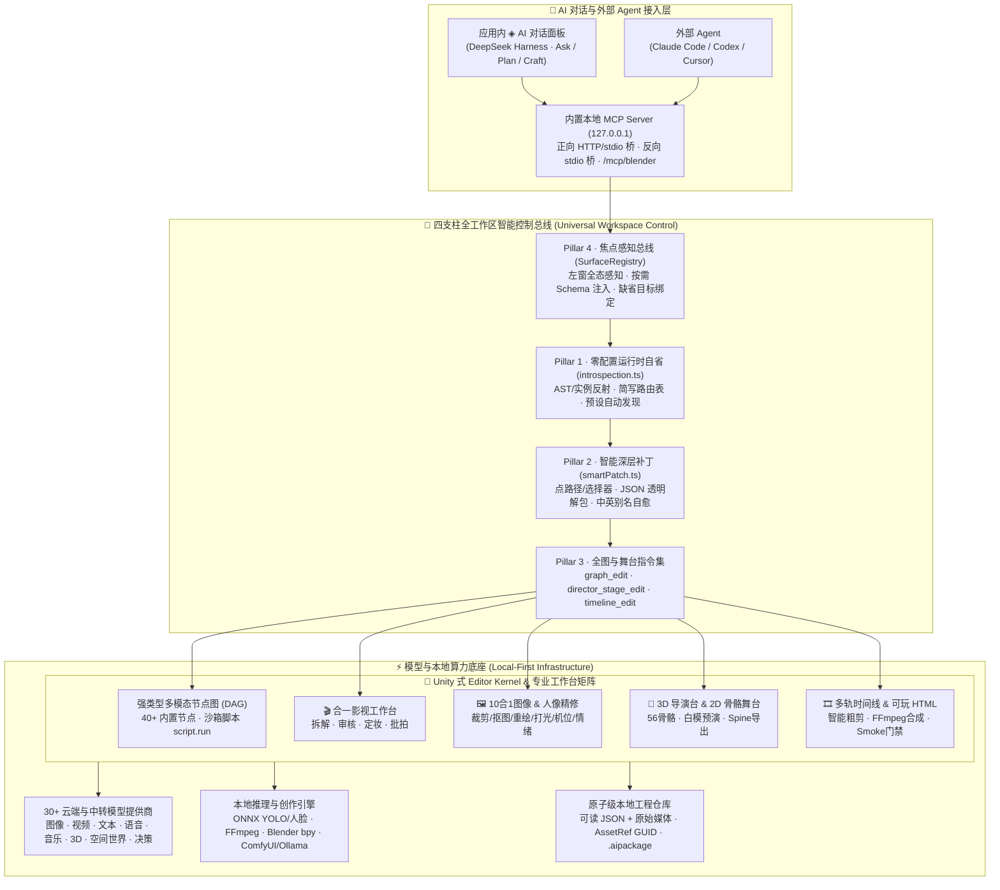

<div align="center">

<a href="https://justin-sky.github.io/ai-art-engine/">
  
</a>

<h1>AI Art Engine</h1>

<p>
  <b>Agent 原生的全模态 AI 美术与影视生产力引擎</b><br />
  <sub>自然语言直控全工作区 · 强类型多模态节点图 · 10+ 专业下钻工作台 · 3D 骨骼导演台 · NLE 多轨时间线 · 30+ 模型本地优先</sub>
</p>

<p>
  <a href="https://github.com/Justin-sky/ai-art-engine/releases"></a>
  <a href="https://github.com/Justin-sky/ai-art-engine/releases"></a>
  <a href="https://github.com/Justin-sky/ai-art-engine/stargazers"></a>
  <a href="./LICENSE"></a>
  
  
</p>

<p>
  <a href="https://justin-sky.github.io/ai-art-engine/"><b>🌐 官方网站</b></a> ·
  <a href="https://justin-sky.github.io/ai-art-engine/quickstart.html"><b>🚀 5 分钟上手</b></a> ·
  <a href="https://justin-sky.github.io/ai-art-engine/manual.html"><b>📖 完整手册</b></a> ·
  <a href="https://space.bilibili.com/3707036976024122"><b>🎬 视频教程</b></a> ·
  <a href="https://github.com/Justin-sky/ai-art-engine/releases"><b>⬇️ 下载安装包</b></a> ·
  <a href="./CHANGELOG.md"><b>📝 更新日志</b></a> ·
  <a href="./README.en.md"><b>English</b></a>
</p>

</div>

---

## ✨ 为什么选择 AI Art Engine？

大多数 AI 创作工具困在两个极端：**要么是只能聊天的对话框**（生成一张图就结束，无法沉淀工程与精准微调），**要么是极其复杂的节点迷宫**（普通用户面对上百个节点参数无从下手）。

**AI Art Engine 将「工业级可视化工作台」与「全工作区 Agent 直控架构」合二为一**：

- 🗣️ **对话即 UI（Conversational Everything）**：无论是画布建图连线、下钻（Dive）子编辑器微调、Inspector 任意深层参数修改，还是 3D 导演台里的演员走位、56 根骨骼旋转、灯光机位运镜，**所有手动能点的操作，在 AI 对话里一句话即可完成**——小白用户零学习成本完成专业级创作。
- 🧩 **全流程闭环（All-in-One Pipeline）**：把**剧本拆解 → 角色/场景定妆 → 3D 导演台白模预演 → 多模态节点图生成（图/视频/语音/音效/音乐/3D/高斯泼溅世界/可玩 HTML） → NLE 多轨时间线粗剪合成**装进同一个本地桌面工程。
- 🔒 **本地优先 & BYOK（Local-First & Zero Lock-in）**：接入 30+ 国内外主流模型与本地 ComfyUI / Ollama / NewAPI；工程就是你硬盘上的可读 JSON 与原始媒体文件，不经过任何第三方中转服务器。

---

## 🔥 六大核心技术与架构亮点

### 1. 四支柱「全工作区对话直控」与零配置自省架构

为彻底消除「UI 加了新节点或新参数，Agent 却不知道怎么改」的行业痛点，项目实现了 **4-Pillar Universal Workspace Control** 架构：

- **Pillar 1 · 运行时 AST/实例自省引擎（[`introspection.ts`](./src/shared/graph/introspection.ts)）**：无需手写重复的 JSON Schema，引擎在运行时自动反射所有已注册节点的 `defaultParams()` 与实时实例，提取完整参数树、枚举范围、无歧义顶层简写路由（`shorthandMap`）及可用预设。**开发者新注册一个节点或新增一个属性，AI 自动零配置适配。**
- **Pillar 2 · 深层点路径与模糊语义自愈补丁（[`smartPatch.ts`](./src/shared/graph/smartPatch.ts)）**：原生支持深层点路径与数组键值选择器（如 `filmStoryboard.shots[index=2].action`、`filmCast.characters[name=林小满].outfit`、`comicPage.panels[0].caption`），对 JSON-string 序列化子文档透明执行 `Unmarshal → Deep Patch → Normalize → Marshal`，绝不冲掉同级未修改字段；自动自愈 `snake_case`、中文口语别名（如 `磨皮: "强烈"`、`瘦脸: "适中"`）并同步重算派生提示词。
- **Pillar 3 · 全图/节点组/预设统一编辑协议（[`mcpGraphEdit.ts`](./src/shared/graph/mcpGraphEdit.ts)）**：单次原子操作批覆盖节点增删改、端口兼容连线、节点组（`group_add/update/delete`）、几何坐标与锁定（`x/y/w/h/locked`）、一键套用预设（`apply_preset`）与 DAG 拓扑自动排版（`auto_layout`）。
- **Pillar 4 · 焦点感知上下文总线（[`surfaceRegistry.ts`](./src/renderer/src/editor/control/surfaceRegistry.ts)）**：实时感知左窗打开的画布、当前下钻（Dive）栈顶视图、3D 导演台场景快照与选中节点，**按需动态注入当前焦点节点的完整可编辑 Schema**，并在 AI 省略 `assetId/nodeId` 时自动绑定到用户眼前的焦点目标。

### 2. 双模 Agent 运行时 + 双向 MCP 协议矩阵（含 Blender 直连）

- **应用内 `◈` AI 对话（DeepSeek Harness）与外部 Agent 同源**：内置 Agent 与外部 **Claude Code、Codex、Cursor** 共享同一套本地 `127.0.0.1` MCP 服务（支持零依赖 `stdio` 桥与 `HTTP Bearer` 直连）。
- **请求级硬权限护栏（`Ask / Plan / Craft`）**：面板模式通过请求头 `X-AIArt-Mode` 在服务端执行**硬门禁拦截**——`Ask` 严禁一切工具调用，`Plan` 在用户确认计划前仅暴露只读工具，`Craft` 放行全量生成与编辑，所有调用落盘 `<userData>/logs/mcp-audit.jsonl` 审计日志。
- **内置 Blender MCP 出站直连（`/mcp/blender`）**：无需安装 `uv` 或额外 Python 子进程，直接连接本机 Blender（同时兼容社区 `blender-mcp` 与 Blender Lab 官方扩展），在对话中执行 `bpy` 建模、材质节点查询、视口离屏截图自查并一键导出 GLB 入库。

### 3. 强类型 DAG 多模态节点图 & 10+ 专业下钻（Dive）工作台

节点图采用严格强类型端口契约（单复数隔离、领域端口校验、Cordis 覆盖栈执行器），双击节点即可无损下钻（Dive）进入专业级全屏工作台：

- 🎬 **合一影视工作台（`film.workbench`）**：剧本智能拆解（场次/分镜/出场实体）→ 导演 AI 审核与返工 → 角色/场景/道具定妆库（支持 `#变体` 继承）→ 批量出图与自动按镜时长生成视频，支持单镜 `film.shot` 节点独立覆写。
- 🖼️ **10 合 1 图像处理工作台（`image.process`）**：单节点集成裁剪、变换、智能构图、宫格切分、本地色彩抠图、AI 语义抠图、局部擦除、局部重绘、画布扩图与高清放大。
- ✨ **非破坏性人像精修 v2（`image.portrait`）+ 本地 ONNX 视觉引擎**：结合 WebWorker 本地推理的 **YOLO 检测/分割/姿态** 与 **两段式人脸关键点模型**，按依赖门禁（`face / mask / pose`）精准控制肤质、五官、眼神光、妆容、身形、光影与证件照排版。
- 💡 **3D 多角度机位（`image.multiAngle`）、球面打光（`image.lighting`）与 5×5 情绪罗盘（`image.emotion`）**：三维交互控件与生图提示词双向实时映射。
- 📖 **漫画分镜排版工作台（`comic.page`）**：斜切刀口分镜格、集中线/速度线/网点滤镜、多形状矢量台词气泡与竖排日漫排版。
- 🦴 **2D 骨骼装配与 Spine 导出舞台（`stage.2d` / `anim.2d` / `frame.animGen`）**：多图层父子骨骼绑定、IK 解算、动作关键帧烘焙，一键导出标准 **Spine 骨架包（`skeleton.json` + `.atlas` + 部件透明图集）** 或稳像透明 GIF。

### 4. 3D 导演台（Director Stage）与 Cinemachine 级分镜预演

- **全功能 3D 虚拟片场**：支持 GLB/GLTF/OBJ/FBX/VRM 模型加载与 **3D Gaussian Splatting（`.spz` / `.ply` 空间世界模型）** 实景漫游。
- **56 骨骼全身姿态与表情控制**：内置人偶支持 25+ 全身姿态预设、手部姿态预设、视线凝视预设，以及任意单根骨骼（如 `leftUpperArm`、`head`、`spine`）的三轴精确旋转。
- **AI 自动走位与几何白模搭建（[`directorWhiteModelBuilder.ts`](./src/renderer/src/features/director/directorWhiteModelBuilder.ts)）**：根据分镜脚本自动计算多角色站位、朝向、家具/桌面道具物理高度（如显示器与咖啡杯自动贴合桌面高度 `y=0.74m`），自动生成多部件几何白模并烘焙 **Cinemachine 运镜轨道**，一键抓拍首帧构图或录制预演视频回填分镜表。

### 5. 一句话可玩 HTML5 游戏编译流水线 + Headless 试玩门禁

- **程序化零素材游戏工程（`gamePlay`）**：Agent 自动生成纯代码合成的 2D/3D 游戏（几何体建模 + Canvas 程序化贴图 + WebAudio 合成器音效 + 确定性种子关卡），宿主通过 `esbuild` 后台打包为单文件 `dist/single.html`。
- **自动化试玩门禁（[`gamePlaySmokeService.ts`](./src/main/services/gamePlaySmokeService.ts)）**：构建完成后自动在隐藏窗口运行真实帧采样，检测未捕获异常、黑屏（亮度阈值）、画面卡死（多帧指纹对比），并将诊断报告回传 Agent 自愈修复。

### 6. Unity 式微内核架构与工业级本地数据管线

- **Cordis 插件化微内核（[`src/renderer/src/editor/kernel`](./src/renderer/src/editor/kernel)）**：统一管理跨视图 Selection、按文档 Scope 隔离的 Command Undo/Redo 栈、生命周期事件与声明式扩展贡献（Inspector、Card、NodeType、Scope、Policy）。
- **原子级持久化与跨工程交付**：采用临时文件 + 原子 `rename` 防损坏写入、`.aiartengine/autosave` 影子恢复、`{ $type: "AssetRef", guid }` 全引用追踪，支持一键导出携带完整依赖图的 `.aipackage` 资产包与插件市场工作流包。

---

## 🏗️ 系统架构全景图



---

## 💬 「开口即所得」：全工作区自然语言指令示例

无需记忆复杂的节点类型或属性名，无论你当前在画布上，还是已经下钻（Dive）进某个子编辑器，直接对左侧 **◈ AI 对话** 说人话：

| 当前所在界面         | 你只需要对 AI 说…                                                              | 引擎底层自动执行的精准操作                                                                                                                     |
| :------------------- | :----------------------------------------------------------------------------- | :--------------------------------------------------------------------------------------------------------------------------------------------- |
| **3D 导演台 Dive**   | 「隐藏林小满，把主光源调成暖橙色、强度 2.5，让男主左大臂抬高 45 度并看向镜头」 | 自动定位当前导演台宿主，调用 `director_stage_edit` 隐藏指定演员、更新光源颜色/强度、旋转 `leftUpperArm` 骨骼并应用视线预设                     |
| **人像精修 Dive**    | 「把磨皮调成强烈，瘦脸适中，加一点眼神光，套用清透日系预设」                   | 自动识别当前焦点节点，通过 `smartPatch` 将中文口语/简写路由至 `portraitRetouch.skinSmoothing='strong'`、`faceSlim='standard'` 并重算生图提示词 |
| **打光 / 机位 Dive** | 「切换成伦勃朗光，水平角转到 45 度，开启轮廓光」                               | 自动套用 `rembrandt` 预设，深度合并 `lightingSetup.yaw=45`、`rimLight=true`，实时刷新三维光位球与 `lightingPrompt`                             |
| **影视工作台 Dive**  | 「把第 2 镜的音效改成急促脚步声与雷声，把林小满的服装改成黑色机能风衣」        | 透明解包 `filmStoryboard` 与 `filmCast` JSON，按选择器定位 `shots[index=2].sound` 与 `entries[name=林小满].description`，无损写回              |
| **漫画排版 Dive**    | 「套用四格漫画模板，设为日漫右到左阅读，第一格标题写『黎明』」                 | 自动套用版式预设，局部更新 `comicPage.readingDirection='rtl'` 与 `comicPage.panels[0].title`，保留其余分镜格与气泡                             |
| **节点画布 / 全局**  | 「新建一个光影节点和人像精修节点连起来，打组叫『精修流水线』，然后自动排版」   | 批量执行 `node_add` + `edge_add` + `group_add` + `auto_layout`，画布实时渲染并记入 Undo 历史                                                   |
| **成片时间线**       | 「把口播里的停顿静默全部剪掉，按转写铺好字幕，抽 4 帧预览给我看」              | 执行 `transcribe_audio` → `timeline_rough_cut`（波纹前移） → `timeline_edit` → `timeline_preview` 回传真实滤镜画面                             |

---

## 🚀 快速开始

### 1. 下载安装

前往 [GitHub Releases](https://github.com/Justin-sky/ai-art-engine/releases) 下载对应系统的安装包：

- **Windows**：`.exe` 安装包
- **macOS**：`.dmg`（Apple Silicon 选 `arm64`，Intel 选 `x64`）
- **Linux**：`.AppImage`

### 2. 三步跑通第一条 AI 创作流

1. 启动应用，进入 **设置 → 模型**，填入任一已有的 API Key（如 DeepSeek、可灵、火山引擎、OpenRouter、NewAPI 或本地 ComfyUI）。
2. 新建工程，在工作区「新建」菜单点击 **「一键工作流」**，选择短剧、绘本、电商或游戏图标模板生成首个画布资产。
3. 点击左侧 **「◈」AI 对话**，用 `@` 引用资产，或者双击任意节点下钻后直接用对话微调参数！

👉 完整图文引导请查阅 [快速上手指南](https://justin-sky.github.io/ai-art-engine/quickstart.html) 与 [在线使用手册](https://justin-sky.github.io/ai-art-engine/manual.html)。

---

## 🔌 接入外部 Agent（Claude Code / Codex / Blender）

应用启动后会在本机 `127.0.0.1` 自动拉起带 Bearer Token 鉴权的 MCP 服务：

```bash
# 方式 A：stdio 桥接入 Claude Code（推荐，需 Node.js 18+）
claude mcp add aiartengine -- node <安装目录或仓库路径>/scripts/mcp-bridge.mjs

# 方式 B：HTTP 直连（无需 Node.js，端口与 Token 见「设置 → MCP 工具服务」）
claude mcp add --transport http aiartengine http://127.0.0.1:43110/mcp \
  --header "Authorization: Bearer <token>"

# 可选：挂载本机 Blender 建模工具集端点
claude mcp add --transport http blender http://127.0.0.1:43110/mcp/blender \
  --header "Authorization: Bearer <token>"
```

详细工具矩阵、权限模式与安全架构请查阅 [`docs/MCP.md`](./docs/MCP.md) 与 [MCP 在线教程](https://justin-sky.github.io/ai-art-engine/guide-mcp.html)。

---

## 🛠️ 从源码构建与扩展开发

环境要求：**Node.js 22+**

```bash
git clone https://github.com/Justin-sky/ai-art-engine.git
cd ai-art-engine
npm install

# 启动开发模式（热重载）
npm run dev

# 运行全量单元测试与双语守卫检查
npm test
node scripts/check-hardcoded-cjk.mjs

# 构建生产包
npm run build
```

**想要开发自定义节点？**  
只需在 [`src/shared/graph/registry.ts`](./src/shared/graph/registry.ts) 调用 `registerNodeType` 定义 `defaultParams()`，**零配置自省引擎（[`introspection.ts`](./src/shared/graph/introspection.ts)）与智能补丁引擎（[`smartPatch.ts`](./src/shared/graph/smartPatch.ts)）会自动发现你的新节点与全部嵌套参数**，立即支持 AI 对话操控！详见 [`docs/GRAPH_PLUGINS.md`](./docs/GRAPH_PLUGINS.md)。

---

## 📚 文档与教程导航

| 角色                      | 推荐阅读                                                                                                                                                                                                                                                                                                                                                              |
| :------------------------ | :-------------------------------------------------------------------------------------------------------------------------------------------------------------------------------------------------------------------------------------------------------------------------------------------------------------------------------------------------------------------- |
| **创作者 / 普通用户**     | [快速上手](https://justin-sky.github.io/ai-art-engine/quickstart.html) · [完整使用手册](https://justin-sky.github.io/ai-art-engine/manual.html) · [AI 对话指南 (`DEEPSEEK_HARNESS.md`)](./docs/DEEPSEEK_HARNESS.md) · [短剧专题教程](https://justin-sky.github.io/ai-art-engine/guide-short-video.html) · [B 站视频教程](https://space.bilibili.com/3707036976024122) |
| **Agent 玩家 / 高级用户** | [MCP 接入全指南 (`MCP.md`)](./docs/MCP.md) · [可玩 HTML 游戏教程](https://justin-sky.github.io/ai-art-engine/guide-gameplay.html) · [ComfyUI 接入](https://justin-sky.github.io/ai-art-engine/guide-comfyui.html) · [NewAPI 网关接入](https://justin-sky.github.io/ai-art-engine/guide-newapi.html)                                                                   |
| **插件作者 / 核心贡献者** | [架构设计 (`ARCHITECTURE.md`)](./docs/ARCHITECTURE.md) · [节点图插件开发 (`GRAPH_PLUGINS.md`)](./docs/GRAPH_PLUGINS.md) · [人像引擎契约 (`PORTRAIT.md`)](./docs/PORTRAIT.md) · [本地 YOLO 视觉架构 (`ARCH_YOLO_LOCAL.md`)](./docs/ARCH_YOLO_LOCAL.md) · [技能市场规范 (`MARKETPLACE.md`)](./docs/MARKETPLACE.md) · [路线图 (`ROADMAP.md`)](./docs/ROADMAP.md)         |

---

## 🤝 参与贡献与社区

欢迎提交 Issue 与 Pull Request！提交前请阅读 [`CONTRIBUTING.md`](./CONTRIBUTING.md)。  
GitHub 为主仓库，[Gitee](https://gitee.com/beijing_blue_whale_era_zhangjian/ai-art-engine) 为国内同步镜像。

<a href="https://github.com/Justin-sky/ai-art-engine/graphs/contributors">
  
</a>

- **QQ 交流群**：`346340389` · `647306826`
- **视频与动态**：[Bilibili @AIArtEngine](https://space.bilibili.com/3707036976024122) ｜ [X @IoKKFOvWAt12669](https://x.com/IoKKFOvWAt12669)
- **商务与反馈**：[284139554@qq.com](mailto:284139554@qq.com)

## 📄 许可证

本项目基于 [GPL-3.0](./LICENSE) 许可证开源。
