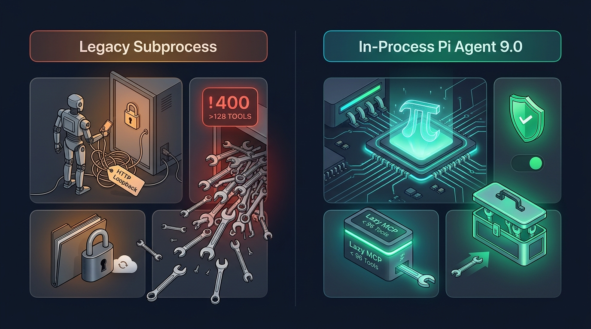
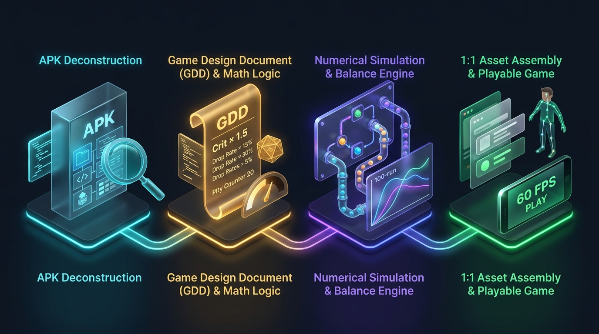
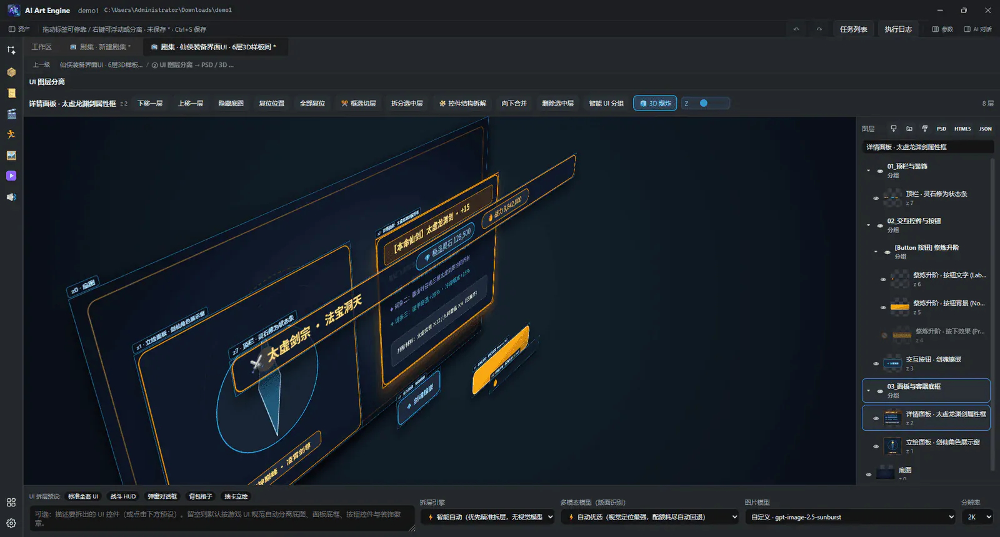

# 把 Pi Agent 塞进开源创作引擎后，我试着丢给它一个游戏安装包：从反编译拆解到 1:1 完美复刻，全程像看科幻片！

> **阅读指南（小白友好版）**：本文没有任何让人头秃的汇编指令和枯燥源码墙。哪怕你一行代码都没写过，也能在 8 分钟内看懂 **新一代内嵌式 Pi Agent 是怎么工作的**，以及 **AI 是如何把一个“黑盒项目”拆成零件、再重新组装成一套完整可玩工程的**。  
> **利益相关**：文末附开源项目 **AI Art Engine（v9.0）** 免费下载与免安装网页试玩地址（GPL-3.0 开源协议，Windows / macOS / Linux 全平台支持）。

---

## 备选爆款标题（发知乎文章 / 回答时按需选用）

1. **主推（悬念 + 爽感 + 技术内核）**：把 Pi Agent 塞进开源创作引擎后，我丢给它一个游戏安装包：从反编译到 1:1 完美复刻有多震撼？
2. **偏小白好奇向**：如果只给 AI 一个打包好的软件/游戏，它能自己反编译看懂，再从零复刻出一个一模一样的吗？
3. **偏技术架构破圈向**：彻底抛弃笨重子进程！我们在桌面引擎里内嵌了 Pi Agent，顺手破掉了全行业头疼的「128 工具上限」
4. **适合挂载的高热知乎问题**：
   - _《目前 AI Agent（智能体）已经进化到什么程度了？有哪些让人眼前一亮的实战案例？》_
   - _《独立游戏开发者如何高效拆解和学习优秀游戏的底层机制与数值？》_
   - _《MCP 协议工具超过 128 个报错怎么破？》_

---

## 正文

### 0. 先抛一个脑洞：只给 AI 一道菜，它能还原出整本秘方并重做一桌吗？

做游戏、做软件或者自学开发的朋友，大概率都遇到过这种让人抓狂的瞬间：

- 团队三年前做过一款数据不错的项目，结果主策离职、文档失踪、源码分支乱成麻瓜，手里**只剩下一个还能正常运行的安装包（比如 `.apk`）**；
- 或者你在研究某款开源独立神作，玩的时候觉得它的**打击节奏、抽卡保底、经济循环**丝滑得不像话，特别想搞清楚：**“它底层到底是怎么算伤害和掉率的？状态机怎么切才不卡手？”**

放在以前，想把一个成品项目“扒透并复刻出来”，你至少得凑齐一套**四人豪华特种部队**：

1. **逆向老哥**：泡着浓茶盯三天反编译工具，从几万个文件里翻核心逻辑；
2. **数值策划**：把代码里的公式抄回 Excel，拉十几张表苦算平衡；
3. **UI 美术**：对着截图一像素一像素重画图层、切九宫格、重新排字；
4. **客户端程序**：把策划案重新敲成 Unity / Godot / HTML5 代码跑起来。

一套流程走下来，半个月过去了，热情早就凉透了。

那如果现在，**把这四个人的活儿，全交给一个住在创作引擎里的 AI Agent 呢？**

这周我们在开源的 **AI Art Engine v9.0** 里干了一件蓄谋已久的大事：**彻底重写了底层的智能体心脏，接入了超轻量的原生 Pi Agent 架构，并打通了工业级逆向技能（REA）与 102 项多模态创作工具。**

实测效果怎么形容呢？

你只需要把合法的自有老包或开源项目安装包丢进工程文件夹，对右侧对话框说一句话，去倒杯水回来——画布上已经整整齐齐“长”出了：

- 一份**带源码行号铁证的完整系统策划案（GDD）**；
- 一张**能自己跑 100 局蒙特卡洛模拟的动态数值沙盘**；
- 一套**进 Photoshop 双击就能改字的真分层 UI（`.psd`）与 Unity/Godot 界面代码**；
- 甚至还有一个**AI 自己写完、自己打开隐身浏览器点按验收通过的可玩原型**！

很多非技术背景的朋友看到这儿肯定会问：**“不是说大模型只会聊天写诗、稍微复杂点就胡说八道吗？它是怎么做到既能拆代码、又能画图建沙盘的？”**

别急，今天我们就把引擎盖掀开，用最接地气的大白话，带你看看这颗 **Pi Agent 心脏** 到底施了什么魔法。


---

### 一、换心脏手术：为什么要把「Pi」直接请进软件主进程？

在聊“怎么反编译复刻”之前，得先交代一句：**为什么以前的 AI 助手干不了这么重的连环活儿？**

在 v9.0 之前，市面上绝大多数桌面软件接 Agent（包括我们自己的老版本），用的都是**「外挂子进程」模式**。

打个小白一听就懂的比方：

> **以前的子进程架构，就像你雇了个「站在门外的外卖小哥」帮你炒菜。**  
> 厨房（你的创作软件）锁在屋里，锅碗瓢盆都在里面。外卖小哥（外部 Agent 进程）站在门外，每切一刀菜，都得给你打个内线电话（本地 HTTP 请求 + 标准输出文本解析）：“老板，帮我把盐递一下！”  
> 更要命的是，小哥手里还死死攥着厨房的记事本不撒手（跨进程文件写锁）——聊到一半你发现 DeepSeek 余额用完了，想顺手切到 Claude 接着炒这盘菜？对不起，**“文件已被另一个进程锁定”**，直接报错罢工！

为了彻底拔掉这根刺，我们在 **AI Art Engine v9.0** 做了一次不留历史包袱的“换心手术”：**基于 `@earendil-works/pi-agent-core` 与 `@earendil-works/pi-ai`，打造了纯正的「进程内原生 Pi Agent 运行时」。**

继续用厨房打比方：**这一次，我们直接把米其林主厨（Pi）请进了自家厨房里！**

它带来了三个让体验脱胎换骨的变化：

#### 1. 零延迟“伸手就拿锅”，随时换脑子不卡壳

现在 Pi Agent 就运行在桌面引擎的主进程内部：

- 调用引擎自带的 **102 项画布、生图、3D Blender、视频剪辑、数值仿真工具** 时，不再绕本地网络请求，而是**零开销的内存函数直调**，指哪打哪；
- 聊天记录采用**无锁原子 JSON 存储**（写完瞬间松手，零文件句柄占用）。哪怕一个复杂项目拆解到第 50 步，你想从 OpenRouter 的 `DeepSeek V4.1` 切到 `Claude Sonnet` 或本地免费的 `Ollama`，下拉框一点，下一秒新模型无缝接棒继续干活！

#### 2. 哆啦 A 梦的「四维口袋」：彻底破掉全行业头疼的 128 工具死限

做过 AI 开发的朋友都知道行业里有一堵著名的叹息之墙——**「128 工具上限」**：

像 OpenAI、DeepSeek 等主流大模型接口都有一条硬规矩：**单次对话最多只允许给 AI 摆上 128 把工具**，哪怕多塞第 129 把，接口直接当场翻脸报错（`400: Invalid 'tools': array too long`）。

可你想想我们要干的事有多重：

- AI Art Engine 自己就有 **102 把创作工具**（建节点、画 UI、绑 2D 骨骼、操控 Blender 建 3D、排剪映时间线……）；
- 再加上外接的专业逆向分析神器 **REA（Reverse Engineer Anything）足足 160+ 把手术刀**（拆安卓 APK、反编译 Java/C#、查二进制符号、追函数调用链……）。

加起来**超过 260 把工具**！一股脑全摊在桌子上，别说接口直接报错炸裂，就算不报错，每说一句话光把这 260 本工具说明书念给 AI 听，就要烧掉几万个 Token 的冤枉钱！

**接入 Pi 之后，我们是怎么优雅破局的？答案就四个字：按需懒加载（`load_toolset`）。**

就像哆啦 A 梦不会把一千件道具全挂在脖子上一样：

1. **轻装出门**：每次开聊，Pi Agent 腰间默认只别着 **24 把最核心的“随身瑞士军刀”**（读写文件、跑命令、读画布 + 一把神奇的 `load_toolset` 召唤钥匙）；
2. **零秒预判 & 随时召唤**：当你说出*“帮我拆解这个 APK 并还原成可玩沙盘”*时，引擎在 0 毫秒内识别出意图，自动从四维口袋里弹出 **「逆向手术包」** 和 **「游戏制作包」**；如果遇到 160 把工具的超大外部工具箱，还会用关键词雷达精准挑出最对口的 **Top 32 把手术刀** 递给 AI；
3. **自动收纳（LRU 淘汰）**：拆完代码进入画图和拼 UI 阶段时，老工具包自动收回口袋，换上视觉与导出工具包，**桌面上活跃的工具永远严格锁死在 `96` 把以内（远低于 128 红线）**！

结果就是：**无论你给引擎接了多少个外部 MCP 插件，永远不会再撞上 128 报错墙，而且日常对话省下了 70% 以上的上下文算力开销。**



#### 3. 副驾上的「安全刹车」：敢放手让它拆包，也不怕它乱动电脑

让 AI 调命令行拆包，小白最怕什么？怕它手滑删错电脑里的个人文件！

我们在 Pi 运行时外层套上了一套**双层原生门禁**：

- **三挡工作模式（`Craft / Plan / Ask`）**：拿不准的时候切到 **`Plan`（规划模式）**，底层的修改类工具会被物理拔除，AI 只能老老实实先给你列方案、弹卡片向你提问确认；你点下「同意执行」的那一秒，它才自动挂挡冲出去干活。
- **盘中实时切换的沙箱护栏（`🛡️ 受限模式` / `🔓 完全访问`）**：平时默认锁在安全的工程沙箱内；当逆向工具（如 `jadx`、`Ghidra`）需要跨目录写缓存时，直接点一下输入框下方的锁头切到琥珀色的 **`🔓 完全访问`**（或者在审批卡上点「本工程总是允许」），正在跑的 Pi Agent 不用中断就能立刻收到放行信号继续推进。

---

### 二、实战高能演示：AI 是怎么把一个项目「拆骨取髓」再 1:1 复刻的？

> **温馨合规提示**：以下演示仅面向**自有历史项目考古还原**（老项目丢文档/丢源码）、**研发期打包后数值走查**及**合法开源项目（MIT/GPL/Apache）学习拆解**。我们只拆解架构状态机与数值机制，绝不碰任何商业加密破解或盗用他人受版权保护的美术素材——因为美术资产我们的引擎自己就能全新生成！

假设现在你新建了一个空白工程，把一个开源肉鸽卡牌安装包的 `.apk` 放进了 `Inputs/` 目录。接下来，好戏开场——总共只需 **4 步**。



---

#### 第一步：拍一张「X 光片」，5 分钟摸清项目底细（绝不瞎读代码）

普通人拿反编译工具解开一个安装包，看到里面几万个文件当场就懵了：90% 都是广告插件、统计组件、系统兼容库，真正的游戏核心藏在哪儿？

在 AI Art Engine 里，你先一句话让它装好逆向专家技能（只需装一次）：

```text
帮我搜索并安装 rea 逆向分析技能
```

接着发出第一道指令：

```text
/reverse-engineer-anything 请对 Inputs/demo-roguelike.apk 做第一阶段快速测绘：
解包识别它用了什么引擎，过滤掉第三方 SDK 噪音，给我画一份《核心玩法模块与配表藏宝图》。
```

这时候看右侧面板，Pi Agent 像一位老练的外科医生：

1. 自动挂载终端与逆向工具，调用解包工具扫描目录骨架；
2. 秒级判断出技术栈（比如：_“这是一个 Unity 项目，核心战斗在 `Game.Battle`，经济与商店在 `Game.Economy`，静态配置表全在 `assets/Configs/*.json`”_）；
3. 把几千个无关的系统库全部屏蔽在视野之外，给你吐出一张干干净净的**《模块地图》**。

**小白看点**：以前工程师要翻半天的目录迷宫，现在 2 分钟变成了一张带路标的中文导游图。

---

#### 第二步：把冷冰冰的代码，榨成「带铁证的祖传秘方」（连暗改保底都藏不住！）

很多大模型看代码有个坏毛病：**看函数名叫 `CalcDamage` 就开始靠想象力瞎编公式。**

但装上 REA 纪律并跑在 Pi Agent 上后，它有一条铁律——**“无源码行号，不准下结论”**。

你发出第二道指令：

```text
顺着刚才的模块地图，把它的核心循环、战斗状态机、伤害乘区公式和抽卡/掉落隐藏规则全部拆出来，写进画布的「游戏系统策划案」节点里。
```

几分钟后，你会看到让人起鸡皮疙瘩的一幕——画布上自动新建了一个 **「游戏系统策划案（GDD）」** 节点，双击点开，里面不再是天书般的代码，而是条理分明的中文设计文档：

- **暴击结算公式**：`最终伤害 = (基础攻击 - 护甲×0.6) × (1 + 增伤区) × 独立乘区`，后面整整齐齐标着 `[BattleCalculator.cs:L142]`；
- **甚至连代码里的“小心思”都被扒了个底朝天**：
  > _“发现隐藏动态难度与保底补偿机制（证据：`DropManager.cs:L88-L103`）：表面显示传说遗物掉率为 `5%`，但当玩家连续 `12` 次未出传说时，每多失败 1 次暗中累加 `+8%` 权重，第 `24` 次必出！”_

哪怕你完全不懂编程，看着这份“人话说明书”，原项目策划脑子里的每一处精妙算计都像透明玻璃一样摆在了你面前！

---

#### 第三步：把抄出来的死公式，变成「能自己跑 100 局」的动态沙盘！

如果只是生成一份文档，那顶多算“高级翻译机”。**真正的魔法从第三步开始：在引擎里原地复活它的灵魂！**

紧接着，Pi Agent 自动调用 `load_toolset` 唤醒 **`game_production`（游戏生产工具包）**，在画布上啪地拍下一个 **「游戏经济与机制沙盘（Machinations v2）」** 节点！

它把刚刚从反编译配表里提取出来的**刷怪掉率、经验升级阈值、商店物价、遗物复利倍率**，自动连成了一张会自己流动的可视化沙盘图：

- 🔺 **水龙头（产出源）**：每波怪物掉多少金币和经验；
- ⭕ **蓄水池（资源池）**：玩家的血条、金币袋、法力槽；
- 🔀 **加工厂（转化器）**：攒够经验触发“三选一升级”、花金币重刷商店；
- 🔻 **下水道（回收漏斗）**：层数递增的怪物伤害与药水消耗。

点一下顶部的 **「▶ 运行模拟」**，系统在几毫秒内替你自动试玩了 **100 局**：

- 原项目为什么第 5 关玩起来特别爽、第 8 关突然有压迫感？看一眼折线图的爬升斜率秒懂！
- **更爽的是“微创新”**：如果你想复刻一款“修仙题材”的新游戏，不用改任何代码，直接在图表上用鼠标把曲线往上一拽（**折线逆向反推公式 Goal-Seek**），或者点一下 **「⚡ 一键配平」**，引擎自动帮你把新数值算得严丝合缝，直接导出全新的 CSV 配表与 C# / GDScript 代码！

---

#### 第四步：像素级工业重构——不是画张假截图，而是吐出全套真工程！

很多网页版 AI 号称“一句话做游戏”，结果只给你生成一张死板的参考图，字是糊的、按钮是抠不下来的，拿给美术和程序看能把人急死。

而住在 **AI Art Engine** 里的 Pi Agent，手握整条多模态工业流水线，复刻出来的是**立刻能进生产线的真家伙**：

1. **游戏 UI 复刻（双击就能改字的真 `.psd`）**：  
   Agent 根据拆解出的界面布局（血条、技能栏、背包弹窗、抽卡结算页），自动生成全新国风/赛博朋克等合规原创视觉，拆分成独立按钮与图标，最终导出一份**带原生可编辑文本层（`TySh`）的 Photoshop `.psd` 源文件** + **Unity UGUI / Godot `.tscn` 节点树**！打开 PS 双击文字就能改字体字号，绝不是一张拍扁的死图。



2. **2D 骨骼角色与 3D 资产复刻**：  
   需要会呼吸、会挥剑的角色？自动走 **Spine 2D 骨骼蒙皮管线** 输出 `skeleton.json + .atlas`；需要 3D 道具和关卡？直接内存直连操控 **Blender** 建模布光导出 `.glb`。
3. **直接生成可玩 HTML5 原型 + AI 自己试玩验货！**  
   最后一步，Agent 把刚才还原出来的状态机、数值配表和新生成的美术音效组装进 **「可玩游戏沙盒节点」**。  
   最绝的是：**它不会写完代码就甩手不管！** 引擎会在后台悄悄拉起一个无头浏览器（Headless Chromium），模拟真人去点开始游戏、放技能、买装备，盯死控制台有没有一行报错、帧率稳不稳定——发现小 Bug 自己改代码重测，直到跑通 **60fps 零报错**，才把可玩窗口推到你面前！

看到这里你回想一下：

从最初文件夹里孤零零的一个老安装包，到画布上**策划案 → 动态数值沙盘 → 分层 PSD UI → 可玩游戏原型**全链路跑通——以前一个 4 人小团队磨半个月的活儿，现在你喝着奶茶、用几句大白话指挥 Pi Agent，一个下午就全在本地电脑上复刻齐活了！

---

### 三、给技术好奇者的彩蛋：跑几百步不断片，底层还藏了什么狠活？

很多用过开源 Agent 跑大项目的同学可能会好奇：**“反编译动辄吐出几万行代码和日志，跑几十轮之后，大模型不会失忆、超长报错或者突然哑巴退出吗？”**

这正是我们在打磨 **AI Art Engine v9.0 / v9.0.1** 时花大力气攻克的三个“隐形护盾”（说出来同样特别好玩）：

1. **给历史长日志做「压缩饼干」（结构化无损上下文折叠）**：  
   拆包时一条终端命令可能吐出 5 万字日志。如果一直原样背在身上，再大的内存也会撑爆。我们的会话引擎会在水位达到 78% 时自动触发“无损折叠”——保留最近几步的完整现场，把更早以前几万字的旧工具输出原位浓缩成精炼的头尾摘要，同时**严丝合缝地保留每一组“提问—工具调用”的配对编号**，既释放了 90% 的空间，又绝不会触发接口报错。
2. **精准识别百万级大窗口 + 思维链断篇「自动接力」**：  
   现在很多新模型（如 `DeepSeek V4.1`、`Gemini 2.5`、`GPT-5.4+`）拥有 **1M（一百万 Token）** 的超大肚量。引擎会自动识别每个模型的真实窗口上限与最小安全输出预算；万一模型在深度思考（Thinking）或者写超长策划案时一口气把单次字数上限用光了，Pi 循环会自动递上一根“接力棒”（自动续写最多 3 轮），让它顺着刚才断掉的半句话无缝往下写，绝不会没出结果就半路闪退。
3. **手滑写歪标点？毫秒级「语法自愈术」**：  
   当 AI 往画布节点里一次性塞入几万字的 Markdown 策划案或复杂脚本时，偶尔会在 JSON 字符串里漏写一个转义斜杠 `\"`，普通软件当场就会解析失败红字报错。我们在底层写了一台有限状态机（`repairMalformedToolJsonString`），能在几毫秒内精准分辨哪些引号是结构边界、哪些是正文内容，悄悄帮大模型把语法瑕疵补齐，让长流程一气呵成。

---

### 四、小白想亲自上手玩一把？给你准备了两条「零门槛通道」

读万卷书不如亲手点两下。整个项目采用 **GPL-3.0 协议永久免费开源**，所有工程文件 100% 存在你自己的电脑硬盘里，没有任何云端按次扣点卡的套路：

#### 通道 1：懒得装软件？3 秒钟直接在浏览器里玩「数值沙盘」！

我们把桌面版同款的 **Machinations v2 游戏机制与经济仿真引擎** 直接搬上了网页，手机电脑点开即玩，内置《杀戮尖塔》《小丑牌（Balatro）》与修仙渡劫等经典数值模板，点一下「▶ 运行」就能看小球跑完 100 回合并体验一键配平：

- **免安装在线试玩沙盘**：https://justin-sky.github.io/ai-art-engine/playground/

#### 通道 2：下载全量桌面版，体验完整「Pi Agent + 反编译复刻 + 全模态工作台」

想体验本文同款的 **Pi Agent 对话建图、REA 逆向拆解、分层 PSD 导出、Spine 2D、Blender 3D 与短剧剪映草稿流水线**：

- **官方网站（产品全景与文档）**：https://justin-sky.github.io/ai-art-engine/
- **GitHub 开源仓库 & 安装包下载（Win / Mac / Linux）**：https://github.com/Justin-sky/ai-art-engine
- **Gitee 国内高速镜像**：https://gitee.com/beijing_blue_whale_era_zhangjian/ai-art-engine

> **新手三句话极速开玩秘籍**：
>
> 1. 下载安装打开软件（内置免 Key 体验样板间，也可在「设置 → 模型接入」填入你自己的 DeepSeek / OpenRouter / Claude Key 或连接本地免费 Ollama）；
> 2. 在右侧对话框发送：`帮我搜索并安装 rea 逆向分析技能`；
> 3. 把合法的自有老包或开源项目放进工程目录，点开输入框下方的 **`🔓 完全访问`**，把你的想法用大白话丢给它——剩下的，就泡杯咖啡看它在画布上表演吧！

如果觉得这套「把真干活的 Pi Agent 塞进工业创作引擎」的思路对你有启发，欢迎去 GitHub 点一颗 **Star ⭐**，也欢迎在评论区聊聊：**如果给你一个能拆解万物并原地复刻的 AI 工作站，你最想拿它复活或研究哪款经典作品？**
