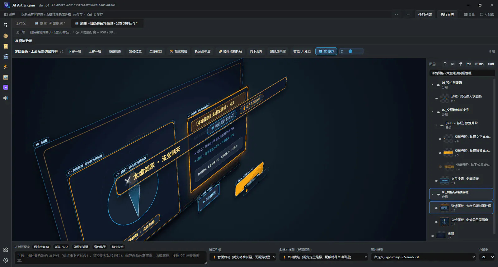
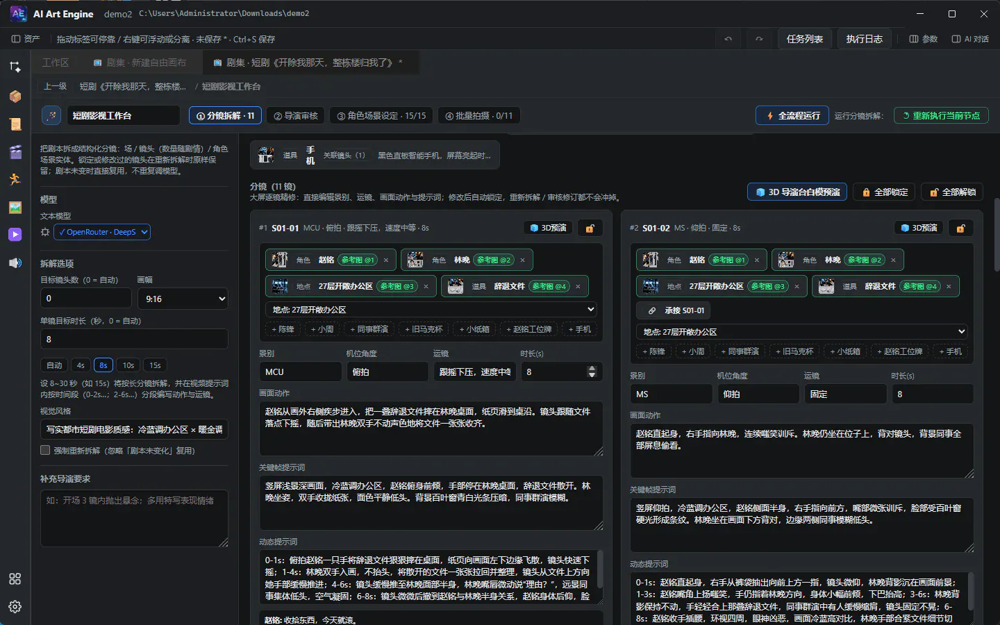

# AI Art Engine 外部榜单冲榜与 PR 截流全套作战包（v8.9.4）

> **核心策略**：零广告预算下，外部榜单是最高杠杆的被动流量机器。本作战包按**投入产出比（单次提交带来的真实 Star / 下载量 / 搜索引擎权重）**分为四大梯队，所有 PR 行、Issue 投稿与表单字段均已严格对齐各榜单维护者的格式规范（字母序、Emoji 标签、字数上限、反营销审查规则），**可直接复制粘贴提交**。

---

## ⚡ 前置动作（3 分钟一次性解锁所有 MCP 榜单）

绝大多数全球 MCP 榜单（`awesome-mcp-servers`、`Glama`、`Smithery`、`mcp.so`、`Official MCP Registry`）都会优先收录并提供绿标认证给支持 `npx` 一键启动的包。仓库内已为你备好零依赖桥接包 [`packages/ai-art-engine-mcp`](../packages/ai-art-engine-mcp) 以及根目录认证清单 [`glama.json`](../glama.json)、[`server.json`](../server.json)：

```bash
cd packages/ai-art-engine-mcp
npm login
npm publish --access public
```

发布后，全球任何 Claude Code / Cursor 用户只需一行命令即可接入你的 102 个工具：

```bash
claude mcp add ai-art-engine -- npx -y ai-art-engine-mcp
```

---

## 🏆 第一梯队：国内开源破圈核爆榜（单次入选可涨 500～3,000+ Star）

### 1. 阮一峰《科技爱好者周刊》（转化率国内第一，周五发布即引爆）

- **投稿入口**：https://github.com/ruanyf/weekly/issues （点击 `New issue` 直接提交）
- **审稿铁律**：阮老师极度反感空泛的“全能 AI 平台”口号，**最偏爱「解决具体工程痛点 + 本地免费开源桌面软件 + 配一张一眼看懂的动图/截图」**。周三或周四上午提交命中率最高！

**Issue 标题（直接复制）**：

```text
自荐开源桌面软件：AI Art Engine —— 把扁平界面截图拆成可改字分层 PSD 与 Unity/Godot 代码，内置开源版 Machinations 游戏数值仿真器
```

**Issue 正文（直接复制）**：

```markdown
你好阮老师，自荐一个我开发的跨平台开源桌面软件 **AI Art Engine**（GPL-3.0，支持 Windows / macOS / Linux）。

- GitHub：https://github.com/Justin-sky/ai-art-engine
- 官网与文档：https://justin-sky.github.io/ai-art-engine/
- 安装包下载：https://github.com/Justin-sky/ai-art-engine/releases

### 解决什么痛点？

现在 AI 生成的图片和视频都是“扁平死文件”——字改不了、层分不开、进不了游戏引擎或剪辑轨道。我做这个本地优先的桌面引擎，核心是把生成结果直接编译成**可编辑的工业工程文件**：

1. **游戏/应用 UI 截图拆层 → 原生可双击改字 PSD (`TySh`) + 多引擎代码**：结合本机离线 OCR 与视觉分割，把一张扁平 UI 图剥离为 16 类控件与九宫格干净底板（支持 3D 爆炸视图检视），一键导出保留 Photoshop 原生可编辑文字层的 `.psd`，并生成 Unity UXML/UGUI、Godot 4 `.tscn` 和 HTML5 代码。
2. **开源平替 Machinations 游戏数值沙盘**：内置 59 款经典游戏经济积木（抽卡软硬保底、护甲减伤、放置产线等），支持蒙特卡洛仿真，并且可以直接在折线图上鼠标拖拽曲线，120fps 逆向反推上游参数公式并导出 C# / GDScript。
3. **2D 立绘自动绑骨导 Spine & 短剧直出剪映草稿**：内置本地免费 ONNX（YOLOv8 / SAM2）推理，支持二次元立绘拆件导出标准 Spine 2D 骨骼包，以及五阶段漫剧分镜直出剪映专业版可编辑多轨草稿。
4. **内置 102 个本地 MCP 工具**：支持多会话并行 Agent 直控，也可让 Claude Code / Cursor 通过 `npx -y ai-art-engine-mcp` 一行命令接管本地工程（内置零 API Key 样板间，打开即可直接体验 3D 拆层与数值沙盘）。

附上软件实机截图：




```

---

### 2. HelloGitHub 月刊（100k+ Star，同步分发公众号 / B站 / 少数派 / 头条）

- **投稿入口**：https://hellogithub.com/ （右上角「提交项目」）或 https://github.com/521xueweihan/HelloGitHub/issues
- **审稿偏好**：看重**高颜值 UI、有趣味性（内置免 Key 样板间 + 祈福仙子与天气特效加分极大！）、全中文开箱即用**。

**项目名称**：`AI Art Engine`  
**项目地址**：`https://github.com/Justin-sky/ai-art-engine`  
**推荐理由（直接复制）**：

```text
一款颜值极高、开箱即用的开源全模态 AI 创作与游戏资产桌面引擎（支持 Win/macOS/Linux，内置免 API Key 交互样板间）。它不生成改不了字的扁平死图，而是直接交付工业级可编辑工程：支持将扁平 UI 截图拆解为 3D 爆炸图层并导出 Photoshop 原生可改字 PSD 与 Unity/Godot 界面代码；内置开源版 Machinations 游戏数值仿真沙盘（59 款积木 + 鼠标拖拽曲线反推公式）；支持 2D 立绘自动识骨导出 Spine 动画包、短剧分镜导出剪映多轨草稿，以及一句话生成单文件可玩 HTML5 游戏。内置 102 个 MCP 工具与多会话并行 Agent，执行任务时画布还有二次元祈福仙子与十种动态天气护航，硬核又好玩。
```

---

### 3. Linux.do / V2EX「分享创造」（国内极客与 AI 玩家密度最高社区）

- **Linux.do 板块**：`开发调优` 或 `前沿快讯`（Linux.do 社区极喜欢“开源免费平替商业软件 + BYOK 自带 API Key + Claude Code MCP 插件”）
- **V2EX 节点**：`/go/create`（分享创造）

**标题（直接复制）**：

```text
[开源] 肝了大半年，做了个本地优先的 AI 游戏美术与漫剧工程引擎：UI 死图转原生可改字 PSD + Godot/Unity、开源版 Machinations 数值反推、102 个 MCP 工具直连 Claude Code
```

**正文（直接复制）**：

```markdown
大家用 AI 生图/做独立游戏或短剧时，最头疼的往往不是“画不出来”，而是**画出来的是一张扁平死图**：想改按钮上的两个字要重抽，想进 Unity/Godot 得手切九宫格，配游戏数值买不起几千块一年的 Machinations，做短剧导不出剪映分轨草稿。

索性自己动手用 Electron + Vue 3 + 本地 ONNX 撸了一套完全开源、数据 100% 落本地硬盘的桌面工作站 **AI Art Engine**（目前迭代到 v8.9.4，内置免 Key 样板间，不填 Key 也能直接把玩核心工作台）：

### 几个最硬核的实用能力：

1. **扁平 UI 截图 → 原生 `TySh` 可双击改字 PSD + Unity / Godot 4 代码**：调系统原生离线 OCR + 视觉分割剥离 16 类控件、自动补全九宫格干净底板，支持 3D 全息爆炸视图预览，导出的 `.psd` 进 Photoshop 直接双击文字工具改字。
2. **100% 机制对齐的开源 Machinations 游戏数值沙盘**：内置 59 款标准数值积木（抽卡软硬保底、RPG 成长、塔防产线），支持蒙特卡洛 P10/P50/P90 置信曲线，甚至能**直接在折线图上鼠标拽曲线，120fps 自动反推上游公式**并导出 C# / GDScript。
3. **2D 立绘 AI 识骨拆件 → 标准 Spine 2D 包**：本机免费跑 YOLOv8-Pose + Alpha 轮廓拆切扩边，直接烘焙 `skeleton.json` + `.atlas`。
4. **21 题材五阶段漫剧工作台 & 爆款视频逆向拆解**：支持角色锁脸、3D 导演台 56 骨白模运镜预演，最终一键导出 **剪映专业版 / CapCut 多轨可编辑草稿**（字幕/配音/画面全分轨）。
5. **多会话并行 Agent + 102 个本地 MCP 工具**：内置最多 6 路会话跨工程并行跑（还塞了个二次元蓝鲸祈福仙子组团施法和十种动态天气缓解等任务的焦虑 😂）。如果你用 Claude Code 或 Cursor，一行命令就能接管：
   `claude mcp add ai-art-engine -- npx -y ai-art-engine-mcp`

- GitHub（GPL-3.0）：https://github.com/Justin-sky/ai-art-engine
- 国内 Gitee 镜像：https://gitee.com/beijing_blue_whale_era_zhangjian/ai-art-engine
- 官网手册与免配置说明：https://justin-sky.github.io/ai-art-engine/
- Win / macOS / Linux 安装包：https://github.com/Justin-sky/ai-art-engine/releases

完全开源免费，走你自己的 API Key（支持 DeepSeek / 火山方舟 / 可灵 / OpenRouter / 本地 ComfyUI / Ollama 等 30+ 渠道）。欢迎各位大佬拍砖提 Issue！
```

---

## 🔌 第二梯队：全球 MCP 权威榜单（精准截流百万 Claude Code / Cursor 开发者）

### 4. `punkpeye/awesome-mcp-servers`（50k+ Stars · 全球第一大 MCP 榜单）

- **仓库地址**：https://github.com/punkpeye/awesome-mcp-servers
- **关键防拒审规范**（维护者用 CI 脚本自动检查，错一个符号都不合并）：
  1. 必须按**字母顺序（Alphabetical order）**插入对应章节（`Justin-sky/ai-art-engine` 按仓库路径排序在 `J` 段）；
  2. Emoji 含义必须严格匹配：`📇` (TypeScript/Node) + `🏠` (Local Service) + `🍎` (macOS) + `🪟` (Windows) + `🐧` (Linux)；
  3. 结尾句号、英文单句精炼描述、不夸大营销词。
- **最佳插入章节**：`### 🎨 Art & Culture` 或 `### 🎮 Gaming`（建议首选 `### 🎮 Gaming`，竞争小、排位显眼、转化极高！）

**PR 插入行（按字母序插在 `J` 位置，直接复制）**：

```markdown
- [Justin-sky/ai-art-engine](https://github.com/Justin-sky/ai-art-engine) 📇 🏠 🍎 🪟 🐧 - Local-first game & creative asset engine exposing 102 MCP tools to compile UI screenshots into editable Photoshop PSDs (`TySh`) and Unity/Godot scenes, rig 2D Spine skeletons, simulate Machinations game economies, drive Blender 3D, and export CapCut timelines.
```

**PR 标题**：

```text
Add Justin-sky/ai-art-engine under Gaming
```

**PR 描述模板**：

```markdown
Adds [Justin-sky/ai-art-engine](https://github.com/Justin-sky/ai-art-engine) (`npx -y ai-art-engine-mcp`) under Gaming.

- **License**: GPL-3.0
- **Transport**: stdio (`npx -y ai-art-engine-mcp`) & local Streamable HTTP (`127.0.0.1:43110/mcp` + `/mcp/blender`)
- **Platforms**: macOS, Windows, Linux (`📇 🏠 🍎 🪟 🐧`)
- **Capabilities**: 102 local tools for editable `TySh` PSD UI splitting, Unity/Godot UI code export, Spine 2D rigging, Machinations economy simulation & curve goal-seek, Blender 3D modeling, offline ONNX vision (`YOLOv8`/`SAM2`), and playable single-file HTML5 generation.
- Placed in strict alphabetical order (`Justin-sky/ai-art-engine`).
```

---

### 5. `appcypher/awesome-mcp-servers` & `wong2/awesome-mcp-servers`

- **仓库地址**：
  - https://github.com/appcypher/awesome-mcp-servers （插入 `### Art & Design` 或 `### Gaming`）
  - https://github.com/wong2/awesome-mcp-servers （同步被 `mcpservers.org` 抓取建站，等于提 1 个 PR 自动上 2 个大站！）

**PR 插入行（直接复制）**：

```markdown
- **[AI Art Engine](https://github.com/Justin-sky/ai-art-engine)** - Open-source local desktop studio with 102 MCP tools (`npx -y ai-art-engine-mcp`) for compiling editable Photoshop PSDs, Unity/Godot UI code, Spine 2D rigs, Machinations game economy simulations, CapCut drafts, and Blender 3D assets.
```

---

### 6. 四大高权重 MCP Web 导航站（无需等审核合并，提交即收录 + 高 Google 权重外链）

仓库根目录已为你放好 [`glama.json`](../glama.json) 与 [`server.json`](../server.json)，以下 5 个站点共只需 **10 分钟**即可全部填完：

| 站点名称                  | 提交直达链接                                        | 填写要点                                                                                                                                                         |
| :------------------------ | :-------------------------------------------------- | :--------------------------------------------------------------------------------------------------------------------------------------------------------------- |
| **Glama MCP Directory**   | https://glama.ai/mcp/servers （点 `Add Server`）    | 填 `https://github.com/Justin-sky/ai-art-engine`，Glama 会自动读取根目录 `glama.json` 授予作者认证徽章，并扫描 `packages/ai-art-engine-mcp` 亮绿灯。             |
| **MCP.so**                | https://mcp.so/submit                               | URL 填 GitHub 仓库地址，Server Config 粘贴下方标准 JSON。                                                                                                        |
| **PulseMCP**              | https://www.pulsemcp.com/submit                     | 每周英文周报覆盖数万 Agent 工程师，提交 GitHub URL 即可。                                                                                                        |
| **Cursor Directory**      | https://cursor.directory/mcp                        | 针对百万 Cursor 用户，主打 _"Give Cursor 102 Game UI / PSD / Spine / Godot / Blender tools"_。                                                                   |
| **Official MCP Registry** | `mcp-publisher publish`（使用根目录 `server.json`） | `npm publish` 后安装官方 `mcp-publisher` CLI，GitHub 登录一键发布至 `registry.modelcontextprotocol.io`（VS Code / GitHub Copilot 原生内置的 MCP 商店数据源！）。 |

**通用 MCP Server Config 字段（各站表单通用复制）**：

```json
{
  "mcpServers": {
    "ai-art-engine": {
      "command": "npx",
      "args": ["-y", "ai-art-engine-mcp"]
    }
  }
}
```

---

## 🎮 第三梯队：全球游戏开发榜单与商业软件“平替”词条（永久被动 SEO 印钞机）

### 7. AlternativeTo.net（海外白嫖商业软件平替的第一搜索站！）

- **提交入口**：https://alternativeto.net/ （右上角 `Add Application`）
- **核心破圈秘诀**：用户不会搜 `AI Art Engine`，但每天有成千上万游戏策划、美术和视频创作者在 Google 搜 **`Machinations alternative free`**、**`Spine 2D open source alternative`**、**`ComfyUI desktop alternative`**！
- **必填关联替代目标（Alternatives to）**：提交时务必把以下软件勾为被替代对象：
  1. **Machinations.io**（最高优先级！目前全网几乎没有带可视化仿真 + 曲线反推的开源桌面替代品，你一旦挂上去就是第一名！）
  2. **ComfyUI**（主打免配环境桌面端 + 下游 PSD/Unity/Godot/剪映工业导出）
  3. **Spine** / **DragonBones**（主打 AI 自动识骨拆件导出 `.json` + `.atlas`）
  4. **Ludo.ai** / **Scenario**（海外游戏 AI 资产平台，月费极贵）

**AlternativeTo 英文简介（直接复制，符合其客观中立审核要求）**：

```text
AI Art Engine is a free, open-source (GPL-3.0), local-first desktop creative and game asset production studio for Windows, macOS, and Linux. It combines a typed multimodal DAG node canvas, 10+ specialized editing workbenches, and a 102-tool local MCP server for AI coding agents. Key features include game UI screenshot splitting to native editable Photoshop PSD (TySh) and Unity/Godot 4 UI code, a Machinations-compatible game economy simulator with 59 building blocks and 120fps curve-drag goal-seek, 2D character bone rigging with Spine export, a 5-stage storyboard workbench with CapCut draft export, live Blender MCP integration, and bundled offline ONNX vision/OCR.
```

---

### 8. 全球高 Star 游戏开发 Awesome 榜单 PR

1. **`ellisonleao/magictools`**（20k+ Stars，游戏开发工具总榜）：https://github.com/ellisonleao/magictools
   - 插入章节：`### Visual Scripting` 或 `### Sprites` / `### Other`
   - **PR 行**：
     ```markdown
     - [AI Art Engine](https://github.com/Justin-sky/ai-art-engine) - Free and open-source local desktop studio that splits UI art into editable PSDs & Unity/Godot scenes, rigs 2D Spine skeletons, simulates Machinations game economies, and exposes 102 MCP tools.
     ```
2. **`Calinou/awesome-gamedev`**（法国 Godot 核心贡献者维护）：https://github.com/Calinou/awesome-gamedev
   - **PR 行**：
     ```markdown
     - [AI Art Engine](https://github.com/Justin-sky/ai-art-engine) - Open-source local game production workbench featuring UI-to-PSD/Godot/Unity compilation, a Machinations-style economy simulator with curve goal-seek, and 2D Spine rigging. _(GPL-3.0)_
     ```
3. **`godotengine/awesome-godot`**（Godot 官方生态榜，Godot 开发者对开源工具极度热情！）：https://github.com/godotengine/awesome-godot
   - 插入章节：`## Plugins and scripts` 或 `## Other`（强调导出 Godot 4 `.tscn` 与 GDScript 经济脚本）

---

## 🚀 第四梯队：海外极客引爆 GitHub Trending（Show HN + Reddit + Product Hunt 新版）

> **冲 GitHub Trending 日榜秘诀**：GitHub Trending 看的是 **24 小时内的 Star 增速斜率**。不要把下面的渠道分散在半个月发，而是集中在 **同一个周二或周三晚上 20:30（北京时间，对应美东早 8:30）** 连环发出，形成 24 小时集中脉冲！

### 9. Hacker News (`Show HN`) —— 极客圈最高含金量入口

- **提交入口**：https://news.ycombinator.com/submit
- **黄金时间**：北京时间周二或周三 **20:30–21:30**
- **铁律**：HN 极度厌恶营销腔（禁用 `revolutionary` / `ultimate` / Emoji），极度欣赏**硬核底层工程细节（手写 PSD `TySh` 二进制描述子、120fps 曲线逆向求解器、本地 ONNX 零云端依赖、GPL 开源）**。

**Title（≤80 字符，严格以 `Show HN:` 开头）**：

```text
Show HN: Open-source desktop engine – UI image to editable PSD/Godot, economy solver
```

**URL**：

```text
https://github.com/Justin-sky/ai-art-engine
```

**发帖后第 1 分钟自己贴上的首条技术评论（Maker Comment）**：

```text
Hi HN, author here.

I built AI Art Engine (Electron + Vue 3 + TypeScript + local ONNX Runtime, GPL-3.0) out of frustration with the "flat dead pixel" problem in generative AI tools: getting a nice PNG of a game UI or character is easy, but turning it into an actual Photoshop file with editable text layers, a Godot 4 `.tscn` layout, a rigged Spine 2D skeleton, or a balanced economy script still takes hours of manual plumbing.

A few engineering pieces under the hood that might be interesting to HN:

1. Binary Photoshop `TySh` text-layer synthesis & 9-slice inpainting: We run native offline OS OCR (WinRT / macOS Vision / Tesseract) + layout parsing to separate 16 game UI control types, sample fill/stroke colors, inpaint clean 9-slice backing plates, and write real editable `TySh` descriptor structures into `.psd` alongside Unity UXML/UGUI and Godot 4 `.tscn` exporters.
2. Deterministic Machinations-style system dynamics & 120fps curve-drag goal-seek: `game.economy` implements pools, converters, gates, traders, Monte Carlo P10/P50/P90 bands, and lets you drag target points or Bezier slope handles directly on the chart to back-solve upstream formulas (`k * pow(STEP, p)`) and export C# / GDScript.
3. Local-first & zero-key sandbox: Bundled `YOLOv8` (detect/segment/pose), face landmarks, and `SAM2` run locally on ONNX Runtime. There is a built-in zero-API-key showcase graph so you can inspect the 3D exploded UI layers and economy sandbox immediately after opening.
4. 102-tool local MCP server (`127.0.0.1:43110`): Both the built-in multi-session parallel agent (up to 6 concurrent sessions) and external agents like Claude Code / Cursor (`npx -y ai-art-engine-mcp`) drive the exact same typed DAG and workbenches.

Repo: https://github.com/Justin-sky/ai-art-engine
Docs: https://justin-sky.github.io/ai-art-engine/

Happy to answer any questions about the PSD binary writer, the economy solver, or the MCP architecture—and brutal feedback is very welcome!
```

---

### 10. Reddit 四大高转化子版块（一区一标题，严防被判群发广告）

1. **`r/godot`**（配一张 UI 图拆解导出 Godot `.tscn` + GDScript 数值脚本的 20 秒录屏 MP4）：
   - **Title**: `I built a free open-source desktop tool that splits flat UI mockups into Godot 4 .tscn scenes + editable PSDs, with an open-source Machinations economy solver`
2. **`r/ClaudeAI`** / **`r/cursor`**（配 Claude Code 调 MCP 操控画布的录屏）：
   - **Title**: `I built an open-source desktop engine that gives Claude Code 102 local MCP tools to output editable Photoshop PSDs, Spine 2D rigs, Godot UI, and playable HTML5 games`
3. **`r/gamedev`**（选 `Showcase` 或 `Resource` Flair，重点讲免费开源数值沙盘与 Spine/UI 管线）：
   - **Title**: `Open-sourced a local game production workbench: Machinations-compatible economy simulator (with curve-drag goal-seek), UI-to-PSD/Unity/Godot splitter, and 2D Spine rigger`
4. **`r/LocalLLaMA`**（重点强调 **Local-first + Ollama / vLLM / ComfyUI + 本地 ONNX 离线视觉**）：
   - **Title**: `AI Art Engine (GPL-3.0): Local-first multimodal DAG & 102-tool MCP studio supporting Ollama, vLLM, ComfyUI, and bundled offline ONNX vision (YOLOv8/SAM2 + native OCR)`

---

### 11. Product Hunt（v8.9.4 全面升级版文案，替换旧版短视频单一叙事）

- **发布时间**：北京时间 **15:05**（美西时间 00:05，吃满整整 24 小时计票周期！）
- **Name**: `AI Art Engine`
- **Tagline（59 字符）**: `Open-source AI game UI, Spine, economy & film studio (+MCP)`
- **Topics**: `Open Source`, `Developer Tools`, `Game Development`, `Artificial Intelligence`, `Design Tools`
- **Description**:
  ```text
  Stop settling for flat, uneditable AI images. AI Art Engine is a free, local-first desktop engine (Win/macOS/Linux) that turns natural-language wishes into real production files:

  • Editable Photoshop PSD (TySh) + Unity & Godot 4 UI code from flat UI art
  • Machinations-compatible game economy sandbox (59 blocks + 120fps curve-drag solver)
  • 2D character auto-rigging to Spine (.json + .atlas) & 4-band wavelet portrait lab
  • 5-stage short-drama studio exporting editable CapCut multi-track drafts
  • 102 local MCP tools (`npx -y ai-art-engine-mcp`) for Claude Code & Cursor + 6-session parallel agent
  ```

---

## 📅 最省力「黄金 7 天冲榜排期表」

| 天数                         | 耗时    | 动作清单                                                                                                                                           | 预期效果                                                           |
| :--------------------------- | :------ | :------------------------------------------------------------------------------------------------------------------------------------------------- | :----------------------------------------------------------------- |
| **Day 1（今晚）**            | 15 分钟 | 执行 `npm publish` 发布 `ai-art-engine-mcp`；向 `punkpeye/awesome-mcp-servers`、`wong2/awesome-mcp-servers`、`ellisonleao/magictools` 提 3 个 PR。 | 锁定全球 MCP 与游戏工具长尾入口                                    |
| **Day 2**                    | 20 分钟 | 填完 `Glama.ai`、`mcp.so`、`PulseMCP`、`Cursor Directory` 与 `AlternativeTo.net`（关联 Machinations.io）。                                         | 获取高权重外链，吃透 Google “Machinations free alternative” 搜索词 |
| **Day 3（周三/四）**         | 15 分钟 | 提交 **阮一峰《科技爱好者周刊》Issue** + **HelloGitHub 自荐**。                                                                                    | 埋下国内最大两波千星级爆发引信                                     |
| **Day 4**                    | 20 分钟 | 发 **Linux.do** 与 **V2EX「分享创造」**，前 1 小时积极回帖互动。                                                                                   | 收获首批 200～500 国内高活跃种子用户与真实反馈                     |
| **Day 5（周二/三晚 20:30）** | 30 分钟 | **集中脉冲日**：同步发 **Hacker News (`Show HN`)** + **Reddit (`r/godot`, `r/ClaudeAI`, `r/LocalLLaMA`)**。                                        | 冲击 **GitHub Trending 日榜 / TypeScript 榜**！                    |
| **Day 6–7**                  | 30 分钟 | 一旦登上 GitHub Trending，立即截图发小红书 / B站 / X 二次发酵，并择机上 **Product Hunt**。                                                         | 触发国内外科技自媒体免费跟进报道，完成破圈闭环                     |
